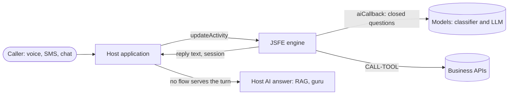
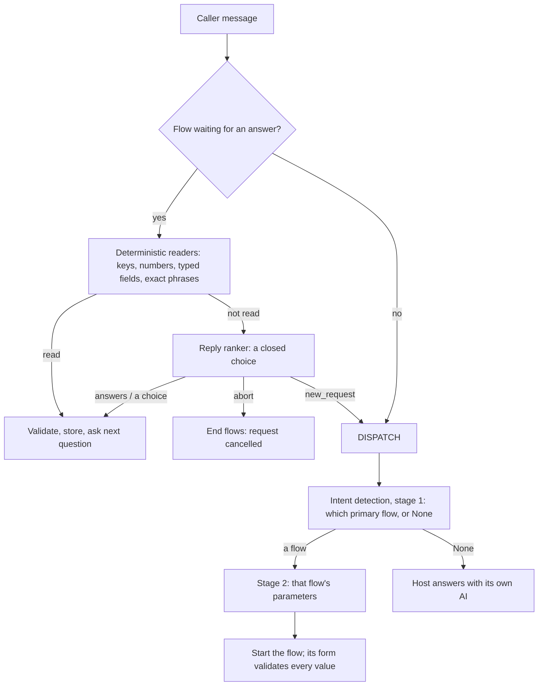

# JSFE flows architecture guide

This guide is for developers new to JSFE. It explains the ideas behind the engine, the building blocks a flow set is
made of, what the caller sees and hears, and how a conversation can feel free and natural while the transactions in it
stay exact and safe. It introduces concepts; the [flow author reference](copilot-reference.md) is the precise
specification, and the [README](../README.md) is the API reference.

The examples use a fictional utility company. Every name and number in them is invented.

## 1. The problem: two kinds of software in one conversation

A caller who phones a utility might say any of these in one call:

- "How much do I owe?"
- "I want to pay 80 dollars with my card ending in 4242."
- "Wait, make it 60."
- "When is it due, by the way?"
- "Actually, can I talk to a person?"

Two very different kinds of software have to serve that call.

**A conversational AI** understands people. It copes with any wording, any language, answers out of order, changes of
mind and questions in the middle of a task. But it guesses, and a guess is never acceptable when money moves.

**A transactional script** is exact. It verifies the caller, collects every required field, reads the amount back,
asks for a clear YES and charges the card once. But a classic script is rigid: one question at a time, one expected
answer, and anything else is "Sorry, I didn't understand."

JSFE joins the two. **The flow owns the transaction; the AI helps only with understanding language, and every AI
decision is a choice from a short closed list that the flow then checks.** The AI never writes a value into a
payment, never confirms a charge and never decides what the business does.

## 2. The big picture



- **The host** is your application: it owns the channels (phone, text, web), credentials, storage, model
  configuration and turn order. It calls `engine.updateActivity(...)` once per caller message and saves the session the
  engine returns.
- **The engine** runs flows. It decides whether the message belongs to a flow in progress, starts a new flow, or hands
  the turn back to the host.
- **Models** are reached only through the host's `aiCallback`. The engine builds every question it asks a model, and
  decodes every answer, so a host never interprets a model's output itself.
- **Tools** are the only way a flow touches the outside world (charge a card, send a text, open a ticket).
- **The host's own AI** answers whatever no flow serves: a general question, small talk, a product question answered
  from documents.

## 3. Building blocks

### Flow sets and tools

A flow set is a JSON array of flow definitions (`tenant.flows`) with a matching JSON array of tool definitions
(`tenant.tools`). A host usually composes several sets: the **system** set every tenant shares (identity checks, field
collectors, retries, handoffs), optional product sets (for example a store integration), and the **tenant** set with
that business's own flows. Flows reference each other by id, so a tenant set reuses shared workers instead of copying
them.

### Steps

A flow is made of steps. Most authors need only a handful:

| Step | What it does |
| --- | --- |
| `SAY` | Queue text for the caller. |
| `SAY-GET` | Say the queued text and wait for the caller's answer. |
| `SET` | Compute a value (a JavaScript expression) into a variable. |
| `CASE` / `SWITCH` | Branch on a condition or a value. |
| `FLOW` | Run another flow: `call` (and come back), `replace` or `reboot`. |
| `CALL-TOOL` | Call a registered tool, with an `onFail` route. |
| `END` | Finish this flow and return to the one that called it. |
| `RETURN` | Finish every flow and hand a reply (or the turn) to the host. |
| `DISPATCH` | Finish every flow and send this message to intent detection, as if it were the first message. |

### The four authoring concepts

Steps are the machine code. Authors mostly write **declarations**, and JSFE generates the steps.

| Concept | You declare | JSFE gives you |
| --- | --- | --- |
| **Form** | the inputs a task needs | collection in any order, validation, corrections, resume after a detour |
| **Provider** | the facts a flow can answer and where they come from | answers to exactly the fact asked, behind an identity gate |
| **Performer** | an action: its effect, gate, tool, confirmation and outcomes | a guarded, confirmed, single execution |
| **Worker** | a few explicit steps | a small reusable task (a calculation, a lookup, a handoff) |

**Forms: any order, one question at a time.** A form lists its inputs once. The engine loops: find the first missing
input, ask it, store whatever the answer actually contained, repeat. Because of that loop, a caller who says
everything at once, answers a later question early, corrects an earlier answer, or comes back after a detour needs no
special code:

```json
{
  "declarationVersion": 2, "id": "pay-bill", "primary": true,
  "description": "The caller wants to pay their bill now. Not: a question about a past payment.",
  "form": {
    "inputs": [
      { "name": "account", "field": "account_number" },
      { "name": "amount", "profile": { "kind": "amount", "min": 1, "money": { "currency": "USD", "cardinals": true, "intent": "payment" } },
        "question": "How much would you like to pay?", "question_es": "¿Cuánto desea pagar?" },
      { "name": "card", "form": "collect-credit-card" }
    ]
  }
}
```

Forms nest: a payment form contains a card form, which contains card-number, expiration and security-code fields. An
answer may fill an input of any active form in the chain, so "use the card ending in 4242" is understood while the
payment is still asking for the amount.

**Providers: answer what was asked.** A provider declares a catalog of facts (balance, due date, last payment), each
with its source path, its wording and the identity gate that protects it. JSFE derives the rest from that one catalog:
the `asked` parameter intent detection fills, the words that recognize each fact in the middle of another task, and the
menu offered after an answer. "When is it due?" gets the due date, not a summary of the whole account.

**Performers: actions with guard rails.** A performer is a form plus a declared action:

```json
"performs": [{
  "action": "bill_payment", "effect": "charge", "subject": "form.data.account",
  "gate": { "flow": "verify-caller", "verified": ["cargo.verified"] },
  "flow": "payment-execute", "confirm": { "exact": true },
  "outcomes": { "ok": "resolved", "failed": "unresolved", "unknown": "unresolved" }
}]
```

From that, JSFE refuses to run the action without the gate, binds the confirmation to the exact request the caller
heard, invalidates it when any input changes, and never treats a timeout as success.

**An unknown result.** A timeout after the card may have been charged leaves the result unknown. The engine handles it
for every action: the action is claimed once, a result that is not one of the declared `outcomes` counts as unknown,
and an unknown charge or cancellation is held, never repeated (only a `send` may declare an explicit retry). Where the
payment API accepts an idempotency key, the flow passes one as a tool argument as well.

### Shared data and shared functions

A value several flows use (a catalog, a list of services, a set of phrases) is written once in the set's data entry and
referenced as `{"$data": "path.to.value"}`; expressions read it as `$data.name`. A function several flows use is
written once in the set's functions entry and called as `fn.name(...)`. One source means two flows can never drift
apart.

### Session state

The engine's session holds the flow stacks and `cargo`, the conversation's shared state. Form progress lives in
`cargo.forms`, so a task interrupted by a question, a detour or a different request resumes from where it was when the
caller comes back to it. The host stores the session between turns; the engine never stores anything itself.

### Deploying while conversations are in progress

A new flow set can go live while callers are in the middle of a flow. A flow's `version` decides what happens to them:

- **A minor or patch change** (`1.4.0` to `1.5.0`: new wording, a new fact, a fix) keeps the conversation going on the
  steps already saved in it.
- **A breaking change bumps the major** (`1.5.0` to `2.0.0`): an input, entry argument or shared name removed or
  renamed, or a value whose meaning changed. A conversation saved under the old major ends that task safely on its next
  turn, without running any action or reading the caller's message as an answer, and the caller is asked to state the
  request again.

`continuationBreaks(previousFlows, nextFlows)` compares a set with the deployed one and lists every removed name that
needs a major bump, so a forgotten bump fails the deploy instead of reaching a caller.

## 4. One turn, step by step

Every caller message travels the same path. The order is the design: **deterministic readers first, AI only where
language is genuinely ambiguous, and the host last.**



### Deterministic readers

When a flow is waiting for an answer, the engine first tries to read it without any model: a keypad key, a phone number,
an email, an amount, a card number, a whole-answer phrase of a choice. The rules are strict on purpose:

- **The current question first.** An answer is read against the question being asked, and the inputs that question
  explicitly invites ("type NEW CARD, LINK, or a different amount" invites an amount).
- **Out of order needs the whole signature.** A number fills another field only when the whole number fits it: a
  fragment of a longer number fills nothing.
- **A confirmation is answered only when it is asked.** A stray "yes" never confirms anything that is not the current
  question.
- **One part of an answer never fills two fields.** Two fields of the same form that fit the same words are asked
  about, never ranked.

The engine records every out-of-order fill and every refused reading, so a host can log why a value was taken.

### The reply ranker

When the readers cannot read an answer that has words in it, the engine asks the **reply ranker** one question: what
does this reply do with the question the flow asked? The model picks from a closed list:

| Option | Meaning | What happens |
| --- | --- | --- |
| `answers` | the reply responds to the question | the flow continues; any value still goes through deterministic validation |
| `choice:<key>` | the reply picks one of the question's offered choices | that choice is the answer |
| `abort` | the caller withdraws the request | every flow ends; the caller hears that the request was cancelled |
| `new_request` | the caller asks for something else | DISPATCH: the message goes to intent detection |

Some options are **never offered**, so the ranker cannot pick them: a choice marked `exact` (anything that charges or
cancels) and the YES of a firm confirmation. A ranker can understand "no thanks, maybe later" as NO; it can never
produce a YES to a payment. Options that cost more when wrong need a higher score (a NO that would cancel what the
caller was confirming, or a new request that leaves the question unanswered). A reply that clears no option is
`answers`, and the question is asked again if nothing usable was in it.

### DISPATCH

`DISPATCH` is the bridge back to free conversation. It ends the flows in progress and re-reads the message through
intent detection, in the same turn. If the message starts another flow, that flow starts; if not, the host answers it
with its own AI and the conversation context. Form progress is kept in `cargo.forms`, so when the caller returns to
the task ("OK, let's pay now"), the primary flow starts again and resumes from its saved draft instead of asking
everything again.

A flow can also ask a question whose answer is open ("Describe the problem") with a **contextual DISPATCH**
(`onResponse: "continue"`): the ranker decides whether the reply answers, withdraws or changes the subject, and an
answer's fields are extracted by the same parameter extraction intent detection uses.

**DISPATCH is not giving up.** Sending a caller to a person (the `give-up` worker) happens only after real attempts at
the answer ran out, or a service the flow needs failed. A caller who changed the subject is dispatched, never
transferred.

### Intent detection: two stages

1. **Which flow.** Only primary flows can start this way, and stage 1 reads only their `description`: what should
   start the flow and, in a `Not:` list, what belongs elsewhere. The answer is one flow or `None`.
2. **Which arguments.** For the chosen flow only, stage 2 extracts its parameters: closed values (an enum such as
   `asked: "balance"`, a boolean) and free text. A parameter the model cannot fill is left out, and the flow asks for
   it.

Each stage is one `aiCallback` call that carries instructions for both a classifier and an LLM, so a host can run
either, or race both. JSFE builds both sets of instructions and decodes both answers (`jsfe/host`), which keeps a
production host and a test harness on one implementation.

## 5. Why the transactions stay safe

The conversational freedom above never reaches the transaction directly. These are the guarantees, and where each one
lives:

| Guarantee | How |
| --- | --- |
| No private fact before identity is verified | a provider's `gate` and a performer's `gate` run the verification worker and check the verified paths |
| No value accepted unchecked | every value, whether read, extracted at activation or understood by the ranker, passes the same field validator |
| No charge without a clear YES | `confirm: { exact: true }`: only confirmation words or the option's exact phrases; never offered to the ranker |
| The YES confirms what the caller heard | consent is bound to the request and the input revision; changing any input invalidates it |
| "Yes, but make it 60" is not consent | an answer with YES plus a correction or another request is not approval of the old request |
| No guessed success | an executor reports success, failure or unknown; unknown holds the action, it is never retried as if it failed |
| One effect, once | effects run only through `CALL-TOOL`; the session records the attempt (`lastTurnToolCalls`) and the host never rolls such a turn back |
| No escape from a half-finished effect | `must_complete` keeps a payment's card questions in place instead of dispatching an unreadable answer |

The host keeps its side of the contract: one `updateActivity` at a time per conversation; a cancelled turn is awaited,
not abandoned; a turn that attempted a tool is never restored to its earlier session; and external effects carry an
idempotency key where the backend supports one. The [README](../README.md) section "Host Responsibilities: Tool Calls,
Cancellation and Concurrency" explains each rule and the production incident behind it.

## 6. What the caller sees and hears

### Messages

- **`SAY` and `SAY-GET`** carry `value` and a per-language variant (`value_es`); the session's language picks one.
- **Voice and text differ.** A question may have written wording for text (`question_text`) and spoken wording for a
  call. On a call, offer keys ("press 1 or say YES"); in text, never say "press".
- **Spoken values.** Helpers read amounts, dates and last-four digits naturally on a call (`amountToSpeech`,
  `dateToWords`, `last4`).

### Questions and answers

- **Choices.** A choice has a key, phrases in each language and, on a call, keypad keys. A key matches only as the
  whole answer. Sensitive choices are `exact`.
- **Confirmations.** `confirmation: "firm"` for consent (a charge, a cancellation, storing a card, filing a request):
  only confirmation words. `"soft"` for an offer ("Would you like a link?"): the wider YES vocabulary.
- **Proposals.** When the flow infers a value ("Is this the card ending in 4242?"), a proposal asks the caller to
  approve that one value. It never authorizes the final action.
- **Questions in the middle of a task.** "When is it due?" asked while paying is answered from the provider's catalog,
  and the payment asks its question again.
- **Menus after an answer.** A provider may offer a short menu ("To make a payment, say PAY. For a payment link, say
  LINK."). Menu choices start their flows; "no thanks" ends politely.
- **Misses.** The first unreadable answer is acknowledged and the question is asked again; validator rejections have
  their own budget (`max_attempts`) with a declared recovery (`on_exhausted`). Every question also accepts a request
  for a person.

### Endings

A flow ends with an outcome (`resolved`, `unresolved`, `deflected`, or `pending` for a task that was paused), and may
give the host recovery guidance (`resume`, `restart`, `hold`, `none`). Hosts use these for reporting and for what to
say when the conversation returns.

## 7. A conversation, annotated

```text
Caller: Hi, I want to pay my bill.
```
Intent detection, stage 1, picks `PayBill`; stage 2 finds no amount. The form's first missing input is the account.

```text
Agent:  To make a payment, I first need to verify your account. Please say or enter your account number.
Caller: 4417 2209
Agent:  I found the account. Please enter the 6-digit code I just sent to your phone ending in 12.
Caller: 381 552
```
Deterministic readers: the account number and the code are typed fields. The identity gate is now satisfied.

```text
Agent:  Your amount due is $84.20. How much would you like to pay?
Caller: When is it due, actually?
Agent:  Your payment is due on November 5. How much would you like to pay?
```
The question is a provider fact asked mid-form: answered, and the form asks its question again.

```text
Caller: Let's do 60 with the card ending in 4242.
```
One answer fills two fields: the amount (the current question) and the card (an input of the nested card form).

```text
Agent:  I'll charge $60.00 to the card ending in 4242. Say YES to pay, or NO.
Caller: Yeah, but make it 70.
```
Not consent: YES plus a correction. The amount changes, the confirmation is invalidated, and the read-back is asked
again for $70.00.

```text
Agent:  I'll charge $70.00 to the card ending in 4242. Say YES to pay, or NO.
Caller: Yes.
Agent:  Your payment of $70.00 was successful. Is there anything else I can help you with?
Caller: Do you have energy-saving rebates?
```
An exact YES to the current confirmation runs the charge once. The last question is not something this flow reads:
the ranker says `new_request`, DISPATCH sends it to intent detection, no flow serves it, and the host's own AI answers
it from the company's documents.

## 8. Design rules worth keeping

1. **Declare, don't script.** Write the manifest (inputs, facts, actions) first; let JSFE generate the steps.
2. **Support what the question invites, DISPATCH the rest.** Never build a natural-language interpreter for one field.
3. **One source for everything.** Shared workers, shared data, shared functions: copies drift.
4. **Flow behavior lives in flows.** Offers, prompts and wording belong to flow steps, not to the host. If a flow cannot
   express something, it is a feature request for the engine.
5. **Side effects only through `CALL-TOOL`,** with an `onFail` route and a declared answer for an unknown result.
6. **Sensitive decisions are exact.** Any choice that charges or cancels is `exact`, and asked as a firm confirmation.
7. **Descriptions are for detection only.** A primary's description says what starts it and what does not; caller
   wording belongs in questions and fact renderers.
8. **Test journeys, not just units.** Run the real engine on the real set: in order, out of order, all at once,
   corrected, a mid-form question, a change of subject, a decline, voice and text, every language.

## Where to read next

- [Flow author reference](copilot-reference.md): every field, step, profile and rule, precisely.
- [README](../README.md): engine API, `aiCallback`, intent detection, the reply ranker and host responsibilities.
- [System flows](flows/system/README.md): the shared workers, a page and a chart per flow.
