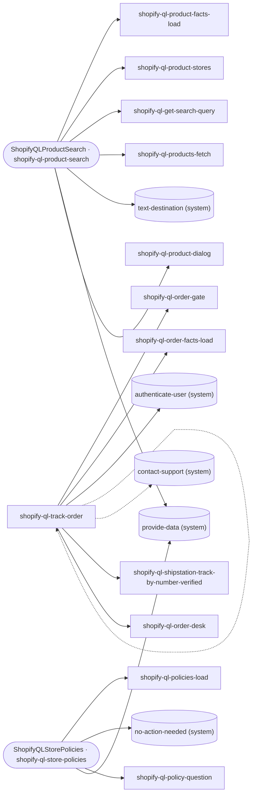

# Shopify flows

<!-- generated:start -->
49 flows (3 entry points), 10 tools. The graph shows each entry point and the flows it reaches directly; a dotted arrow is a flow named rather than called (a hook, a prepare or present step, a default target). Each flow page charts its declarations: a provider (gate, source, facts, menu), a form (inputs in order, then its after steps), a performer (prepare, present, action) and any step list.

## Entry points

| flow | kind | what it is |
|---|---|---|
| [shopify-ql-product-search](shopify-ql-product-search.md) | steps | Find a product, price, or online/store availability, including a product named alone ('a Minions costume', 'tires'). Follow-up questions ab… |
| [shopify-ql-track-order](shopify-ql-track-order.md) | steps | Customer asks about an order or purchase they placed, or a package: its status, when it will arrive or be ready for pickup, where it is, it… |
| [shopify-ql-store-policies](shopify-ql-store-policies.md) | steps | Customer asks about store policy or FAQ terms: returns, refunds, exchanges, shipping or delivery rules ('what is your return policy', 'do y… |

## Workers

| flow | kind | what it is |
|---|---|---|
| [shopify-ql-get-search-query](shopify-ql-get-search-query.md) | form + steps | Collect the product query exactly as spoken, using the shared contextual collector. |
| [shopify-ql-products-fetch](shopify-ql-products-fetch.md) | steps | Retrieve a new public catalog result and replace the prior context only with a valid response. |
| [shopify-ql-product-facts-load](shopify-ql-product-facts-load.md) | steps | Project only supported facts from the result list actually shown; keep ordinal positions stable. |
| [shopify-ql-product-dialog](shopify-ql-product-dialog.md) | form + steps | Collect the next question about shown products; unknown requests yield through the shared FORM contract. |
| [shopify-ql-product-stores](shopify-ql-product-stores.md) | form + steps | Collect the listed product and nearby city/state/ZIP, then retrieve live store inventory for its variant. |
| [shopify-ql-product-variant](shopify-ql-product-variant.md) | form + steps | Choose one descriptively labeled source variant for physical-store inventory. Online stock never implies the intended variant. |
| [shopify-ql-product-selection-prepare](shopify-ql-product-selection-prepare.md) | steps | Offer only the product positions the channel actually showed. |
| [shopify-ql-product-dialog-prepare](shopify-ql-product-dialog-prepare.md) | steps | Offer only supported store and text actions for this channel. |
| [shopify-ql-product-query-validate](shopify-ql-product-query-validate.md) | steps | Classify a product query before committing it. |
| [shopify-ql-product-dialog-validate](shopify-ql-product-dialog-validate.md) | steps | Distinguish a question about shown results from a new product request before accepting it. |
| [shopify-ql-product-city-validate](shopify-ql-product-city-validate.md) | steps | Classify a candidate place before accepting it or requesting inventory. |
| [shopify-ql-product-location-retry](shopify-ql-product-location-retry.md) | form + steps | Ask once for a corrected city or ZIP after a geocoding miss. |
| [shopify-ql-product-stores-present](shopify-ql-product-stores-present.md) | steps | Present live store inventory without fabricating locations, quantities or geocoding success. |
| [shopify-ql-product-links](shopify-ql-product-links.md) | form + steps | Send only the product links shown, to the explicitly resolved text destination, after a TEXT request. |
| [shopify-ql-product-links-prepare](shopify-ql-product-links-prepare.md) | steps | Prepare links for exactly the products the channel showed, without including unoffered results. |
| [shopify-ql-product-links-present](shopify-ql-product-links-present.md) | steps | Report link delivery only from the guarded send result. |
| [shopify-ql-tracking-unavailable](shopify-ql-tracking-unavailable.md) | steps | End an unavailable tracking exchange with the configured support contact; never invent a delivery date. |
| [shopify-ql-tracking-help](shopify-ql-tracking-help.md) | steps | Explain where a carrier number is found once per owned tracking form, then hand off without an indefinite re-ask. |
| [shopify-ql-order-gate](shopify-ql-order-gate.md) | steps | Verify the current Shopify contact and invalidate every private cached projection before a subject change. |
| [shopify-ql-orders-fetch](shopify-ql-orders-fetch.md) | steps | Load the verified customer orders through the shared subject-scoped source lifecycle. |
| [shopify-ql-orders-load](shopify-ql-orders-load.md) | steps | Retrieve orders for exactly the verified email or phone; a different proposed customer provides no orders. |
| [shopify-ql-order-detail](shopify-ql-order-detail.md) | steps | Load a focused order only under its verified contact; use shared source lifecycle and exact per-contact caches. |
| [shopify-ql-order-detail-load](shopify-ql-order-detail-load.md) | steps | Retrieve one verified order, distinguish a missing order from a failed service, and preserve carrier fallback. |
| [shopify-ql-order-shipments](shopify-ql-order-shipments.md) | steps | Retrieve each distinct package tracking number once under the already verified focused order; preserve per-package fallback. |
| [shopify-ql-order-carriers](shopify-ql-order-carriers.md) | steps | Load independent shipment status only for a tracking or delivery fact, not an item/details question. |
| [shopify-ql-order-desk](shopify-ql-order-desk.md) | steps | Select a verified order, answer one catalog-declared fact, and transfer each contextual follow-up into its owning FORM. |
| [shopify-ql-no-orders](shopify-ql-no-orders.md) | steps | No order was found for the caller: a tenant wrapper that asked for it (no_orders 'return') gets the caller back; otherwise ask for a tracki… |
| [shopify-ql-order-pickup](shopify-ql-order-pickup.md) | steps | Answer whether the selected order is a store pickup and where it stands: Shopify's pickup delivery method, or the tenant's own reading (car… |
| [shopify-ql-order-facts-load](shopify-ql-order-facts-load.md) | steps | Project localized focused-order facts from the verified Shopify detail and available carrier evidence. |
| [shopify-ql-order-track](shopify-ql-order-track.md) | steps | Provide where the package is and its tracking for the verified focused order. |
| [shopify-ql-order-delivery](shopify-ql-order-delivery.md) | steps | Provide when the order arrives or was delivered for the verified focused order. |
| [shopify-ql-order-items](shopify-ql-order-items.md) | steps | Provide what is in the order for the verified focused order. |
| [shopify-ql-order-details](shopify-ql-order-details.md) | steps | Provide order state, total, items and shipping address for the verified focused order. |
| [shopify-ql-order-reply-check](shopify-ql-order-reply-check.md) | steps | Read a contextual order question or selection, using typed semantic continuation only when local field ownership cannot decide. |
| [shopify-ql-order-question](shopify-ql-order-question.md) | form + steps | Collect one contextual order selection or follow-up using the standard reentrant FORM protocol. |
| [shopify-ql-tracking-inputs](shopify-ql-tracking-inputs.md) | form + steps | Collect a carrier tracking number through generic input matching; answer where to find it before resuming. |
| [shopify-ql-tracking-number-check](shopify-ql-tracking-number-check.md) | steps | Normalize a complete carrier identifier without joining arbitrary spoken words into a false number. |
| [shopify-ql-tracking-load](shopify-ql-tracking-load.md) | steps | Retrieve carrier status for an explicitly collected number; no inferred delivery state. |
| [shopify-ql-shipstation-track-by-number-verified](shopify-ql-shipstation-track-by-number-verified.md) | steps | Verify the contact, collect a carrier number, retrieve real status and permit one explicit not-found correction. |
| [shopify-ql-policy-question](shopify-ql-policy-question.md) | form + steps | Collect the policy question as spoken; the generic collector owns agent, exit, retry and resumable yield behavior. |
| [shopify-ql-policy-question-validate](shopify-ql-policy-question-validate.md) | steps | Classify a proposed policy question before accepting it; preserve the live collector when it remains a policy response. |
| [shopify-ql-policies-load](shopify-ql-policies-load.md) | steps | Retrieve policy matches for the current question; only nonempty textual FAQ answers can become provider evidence. |
| [operation:shopify-search-products](operation:shopify-search-products.md) | steps | Execute registered tool shopify-search-products; return its transport outcome. |
| [operation:shopify-search-policies](operation:shopify-search-policies.md) | steps | Execute registered tool shopify-search-policies; return its transport outcome. |
| [operation:shopify-store-availability](operation:shopify-store-availability.md) | steps | Execute registered tool shopify-store-availability; return its transport outcome. |
| [operation:get-whatsapp-link](operation:get-whatsapp-link.md) | steps | Execute registered tool get-whatsapp-link; return its transport outcome. |
<!-- generated:end -->

## How to read these docs

Each flow page has a generated part (facts and charts, rewritten from `flows/shopify.flows.json`). Run `node scripts/flow-docs.mjs` after changing `flows/`. The other sets: [system](../system/README.md).
