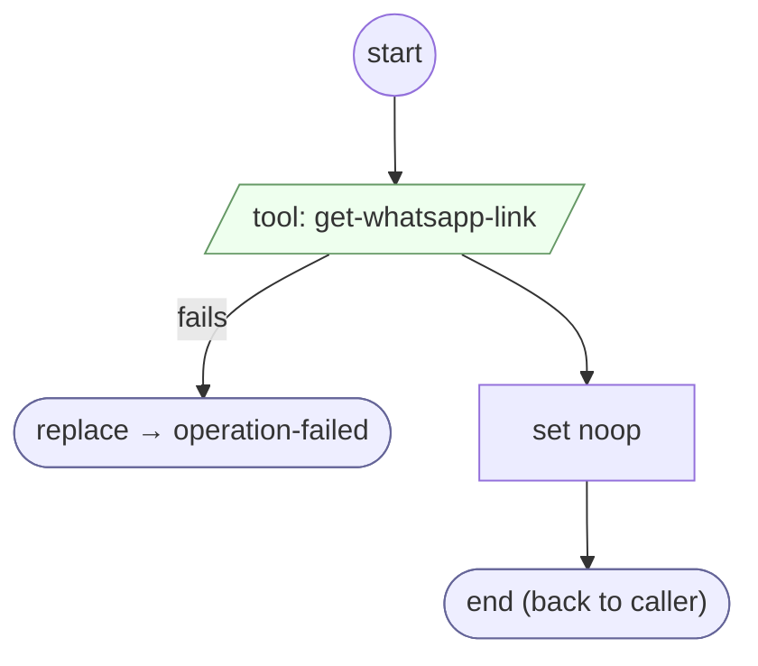

# Operation get-whatsapp-link

<!-- generated:start -->
**Operation get-whatsapp-link** · `operation:get-whatsapp-link` · version 1.0.0 · worker (called by other flows) · steps · isolated scope

> Execute registered tool get-whatsapp-link; return its transport outcome.

- **Parameters:** 
  - `request`: Explicit tool arguments
- **Calls:** [operation-failed](../system/operation-failed.md) (system) (replace)
- **Tools:** `get-whatsapp-link`
- **Called by:** [shopify-ql-product-links-prepare](shopify-ql-product-links-prepare.md)

### Steps

<!-- generated:end -->
