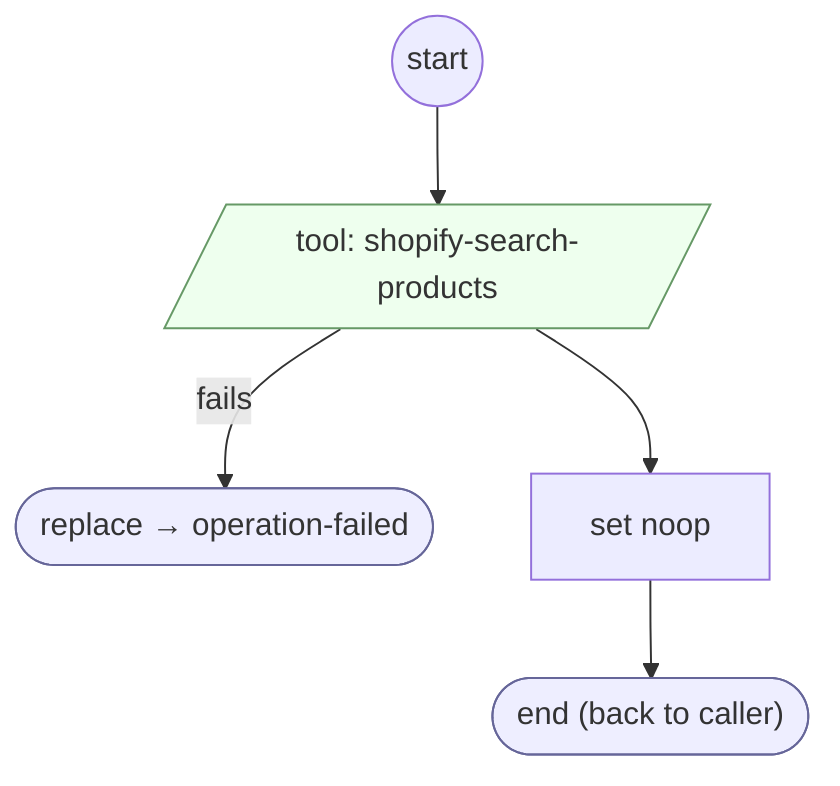

# Operation shopify-search-products

<!-- generated:start -->
**Operation shopify-search-products** · `operation:shopify-search-products` · version 1.0.0 · worker (called by other flows) · steps · isolated scope

> Execute registered tool shopify-search-products; return its transport outcome.

- **Parameters:** 
  - `request`: Explicit tool arguments
- **Calls:** [operation-failed](../system/operation-failed.md) (system) (replace)
- **Tools:** `shopify-search-products`
- **Called by:** [shopify-ql-products-fetch](shopify-ql-products-fetch.md)

### Steps

<!-- generated:end -->
