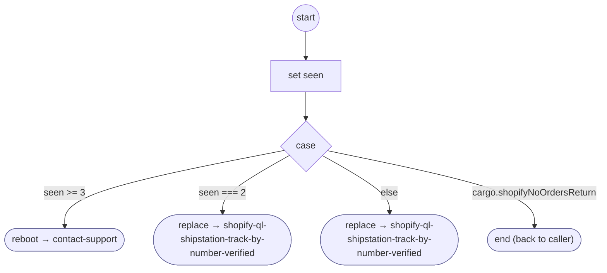

# ShopifyQLNoOrders

<!-- generated:start -->
**ShopifyQLNoOrders** · `shopify-ql-no-orders` · version 1.0.0 · worker (called by other flows) · steps · isolated scope

> No order was found for the caller: a tenant wrapper that asked for it (no_orders 'return') gets the caller back; otherwise ask for a tracking number, asked again in the same conversation say where it is and ask once more, a third time hand off to support (owner 2026-10-24).

- **Parameters:** 
  - `intro_message`: What to say before asking for the tracking number
  - `intro_message_es`: The same in Spanish
- **Calls:** [contact-support](../system/contact-support.md) (system) (reboot), [shopify-ql-shipstation-track-by-number-verified](shopify-ql-shipstation-track-by-number-verified.md) (replace)
- **Tools:** none
- **Called by:** [shopify-ql-order-desk](shopify-ql-order-desk.md)

### Steps

<!-- generated:end -->
