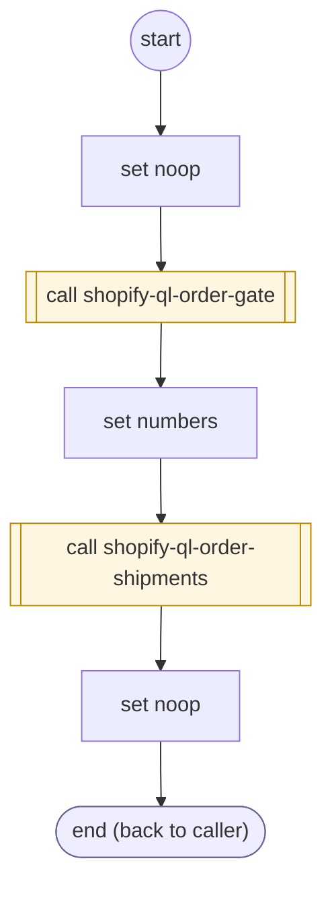

# ShopifyQLOrderCarriers

<!-- generated:start -->
**ShopifyQLOrderCarriers** · `shopify-ql-order-carriers` · version 3.0.0 · worker (called by other flows) · steps · isolated scope

> Load independent shipment status only for a tracking or delivery fact, not an item/details question.

- **Parameters:** none
- **Calls:** [shopify-ql-order-gate](shopify-ql-order-gate.md) (call), [shopify-ql-order-shipments](shopify-ql-order-shipments.md) (call)
- **Tools:** none
- **Called by:** [shopify-ql-order-facts-load](shopify-ql-order-facts-load.md)

### Steps

<!-- generated:end -->
