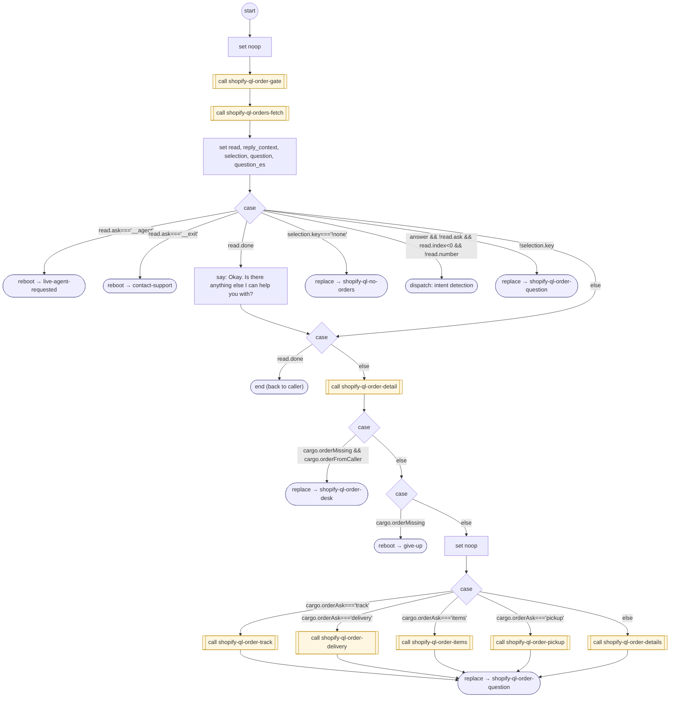

# ShopifyQLOrderDesk

<!-- generated:start -->
**ShopifyQLOrderDesk** · `shopify-ql-order-desk` · version 3.0.0 · worker (called by other flows) · steps · isolated scope

> Select a verified order, answer one catalog-declared fact, and transfer each contextual follow-up into its owning FORM.

- **Parameters:** 
  - `answer`: Internal contextual order reply
  - `reply_context`: Accepted FORM reading bound to its exact raw reply and verified subject
- **Calls:** [shopify-ql-order-gate](shopify-ql-order-gate.md) (call), [shopify-ql-orders-fetch](shopify-ql-orders-fetch.md) (call), [live-agent-requested](../system/live-agent-requested.md) (system) (reboot), [contact-support](../system/contact-support.md) (system) (reboot), [shopify-ql-no-orders](shopify-ql-no-orders.md) (replace), [shopify-ql-order-question](shopify-ql-order-question.md) (replace), [shopify-ql-order-detail](shopify-ql-order-detail.md) (call), [shopify-ql-order-desk](shopify-ql-order-desk.md) (replace), [give-up](../system/give-up.md) (system) (reboot), [shopify-ql-order-track](shopify-ql-order-track.md) (call), [shopify-ql-order-delivery](shopify-ql-order-delivery.md) (call), [shopify-ql-order-items](shopify-ql-order-items.md) (call), [shopify-ql-order-pickup](shopify-ql-order-pickup.md) (call), [shopify-ql-order-details](shopify-ql-order-details.md) (call)
- **Tools:** none
- **Called by:** [shopify-ql-track-order](shopify-ql-track-order.md), [shopify-ql-order-desk](shopify-ql-order-desk.md), [shopify-ql-order-reply-check](shopify-ql-order-reply-check.md), [shopify-ql-order-question](shopify-ql-order-question.md), [shopify-ql-tracking-number-check](shopify-ql-tracking-number-check.md)

### Steps

<!-- generated:end -->
