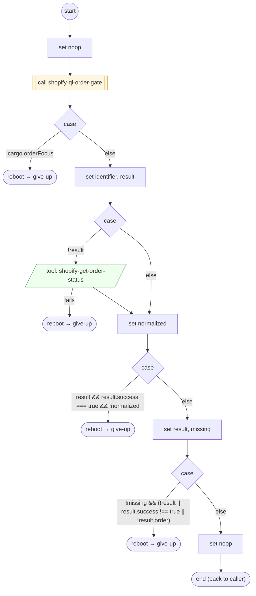

# ShopifyQLOrderDetailLoad

<!-- generated:start -->
**ShopifyQLOrderDetailLoad** · `shopify-ql-order-detail-load` · version 3.0.0 · worker (called by other flows) · steps · isolated scope

> Retrieve one verified order, distinguish a missing order from a failed service, and preserve carrier fallback.

- **Parameters:** none
- **Calls:** [shopify-ql-order-gate](shopify-ql-order-gate.md) (call), [give-up](../system/give-up.md) (system) (reboot)
- **Tools:** `shopify-get-order-status`
- **Called by:** [shopify-ql-order-detail](shopify-ql-order-detail.md)

### Steps

<!-- generated:end -->
