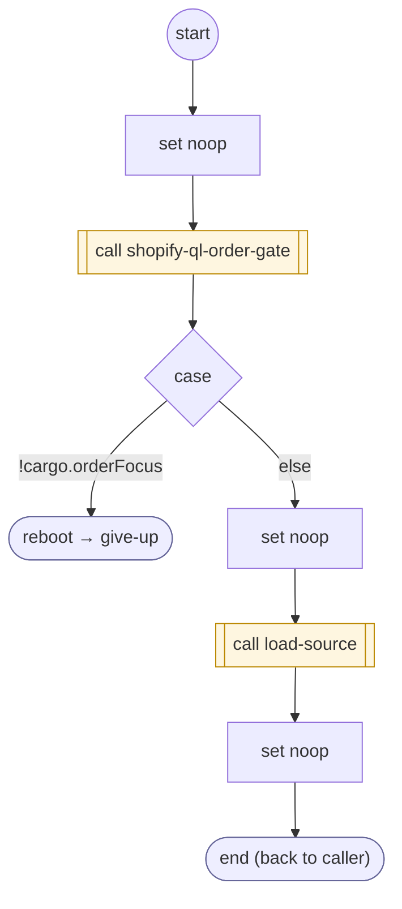

# ShopifyQLOrderDetail

<!-- generated:start -->
**ShopifyQLOrderDetail** · `shopify-ql-order-detail` · version 3.0.0 · worker (called by other flows) · steps · isolated scope

> Load a focused order only under its verified contact; use shared source lifecycle and exact per-contact caches.

- **Parameters:** none
- **Calls:** [shopify-ql-order-detail-load](shopify-ql-order-detail-load.md) (call), [shopify-ql-order-gate](shopify-ql-order-gate.md) (call), [give-up](../system/give-up.md) (system) (reboot), [load-source](../system/load-source.md) (system) (call)
- **Tools:** none
- **Called by:** [shopify-ql-order-desk](shopify-ql-order-desk.md), [shopify-ql-order-facts-load](shopify-ql-order-facts-load.md)

### Steps

<!-- generated:end -->
