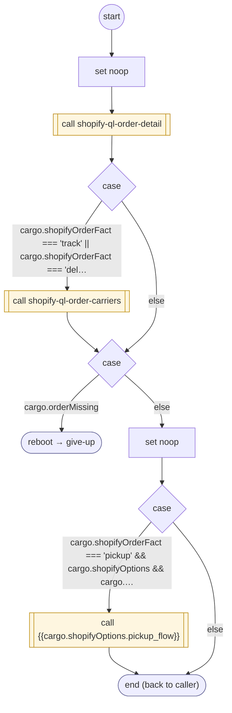

# ShopifyQLOrderFactsLoad

<!-- generated:start -->
**ShopifyQLOrderFactsLoad** · `shopify-ql-order-facts-load` · version 3.0.0 · worker (called by other flows) · steps · isolated scope

> Project localized focused-order facts from the verified Shopify detail and available carrier evidence.

- **Parameters:** none
- **Calls:** [shopify-ql-order-detail](shopify-ql-order-detail.md) (call), [shopify-ql-order-carriers](shopify-ql-order-carriers.md) (call), [give-up](../system/give-up.md) (system) (reboot), {{cargo.shopifyOptions.pickup_flow}} (call)
- **Tools:** none
- **Called by:** [shopify-ql-track-order](shopify-ql-track-order.md), [shopify-ql-order-pickup](shopify-ql-order-pickup.md), [shopify-ql-order-track](shopify-ql-order-track.md), [shopify-ql-order-delivery](shopify-ql-order-delivery.md), [shopify-ql-order-items](shopify-ql-order-items.md), [shopify-ql-order-details](shopify-ql-order-details.md)

### Steps

<!-- generated:end -->
