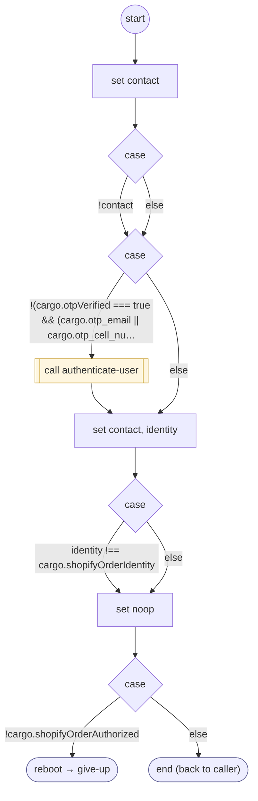

# ShopifyQLOrderGate

<!-- generated:start -->
**ShopifyQLOrderGate** · `shopify-ql-order-gate` · version 3.0.0 · worker (called by other flows) · steps · isolated scope

> Verify the current Shopify contact and invalidate every private cached projection before a subject change.

- **Parameters:** none
- **Calls:** [authenticate-user](../system/authenticate-user.md) (system) (call), [shopify-ql-track-order](shopify-ql-track-order.md) (retry_flow of authenticate-user, retry_flow), [contact-support](../system/contact-support.md) (system) (cancel_flow of authenticate-user, cancel_flow), [give-up](../system/give-up.md) (system) (reboot)
- **Tools:** none
- **Called by:** [shopify-ql-track-order](shopify-ql-track-order.md), [shopify-ql-orders-fetch](shopify-ql-orders-fetch.md), [shopify-ql-orders-load](shopify-ql-orders-load.md), [shopify-ql-order-detail](shopify-ql-order-detail.md), [shopify-ql-order-detail-load](shopify-ql-order-detail-load.md), [shopify-ql-order-shipments](shopify-ql-order-shipments.md), [shopify-ql-order-carriers](shopify-ql-order-carriers.md), [shopify-ql-order-desk](shopify-ql-order-desk.md), [shopify-ql-order-pickup](shopify-ql-order-pickup.md), [shopify-ql-order-track](shopify-ql-order-track.md), [shopify-ql-order-delivery](shopify-ql-order-delivery.md), [shopify-ql-order-items](shopify-ql-order-items.md), [shopify-ql-order-details](shopify-ql-order-details.md), [shopify-ql-order-reply-check](shopify-ql-order-reply-check.md), [shopify-ql-order-question](shopify-ql-order-question.md), [shopify-ql-tracking-inputs](shopify-ql-tracking-inputs.md), [shopify-ql-tracking-load](shopify-ql-tracking-load.md), [shopify-ql-shipstation-track-by-number-verified](shopify-ql-shipstation-track-by-number-verified.md)

### Steps

<!-- generated:end -->
