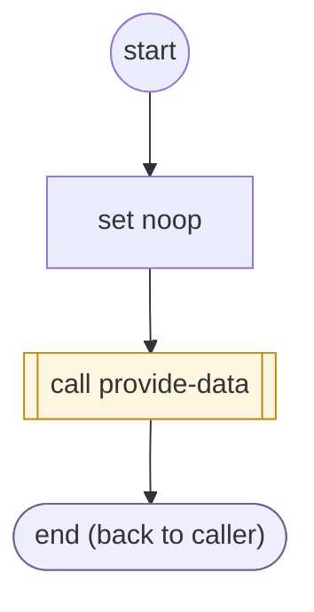

# ShopifyQLOrderPickup

<!-- generated:start -->
**ShopifyQLOrderPickup** · `shopify-ql-order-pickup` · version 4.0.0 · worker (called by other flows) · steps · isolated scope

> Answer whether the selected order is a store pickup and where it stands: Shopify's pickup delivery method, or the tenant's own reading (cargo.shopifyOptions.pickup_flow).

- **Parameters:** 
  - `asked` (track / delivery / items / details): track: where the package is and its tracking. delivery: when the order arrives or was delivered. items: what is in the order. details: order state, total, items and shipping address
- **Calls:** [shopify-ql-order-gate](shopify-ql-order-gate.md) (call), [shopify-ql-order-facts-load](shopify-ql-order-facts-load.md) (call), [provide-data](../system/provide-data.md) (system) (call)
- **Tools:** none
- **Called by:** [shopify-ql-order-desk](shopify-ql-order-desk.md)

### Steps

<!-- generated:end -->
