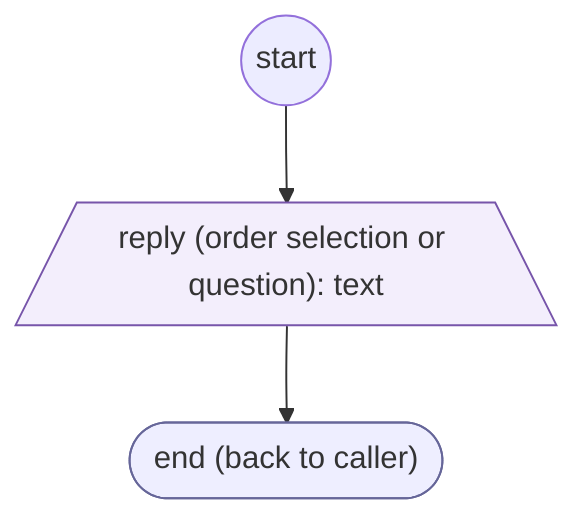
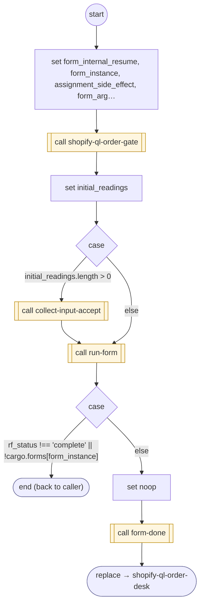

# ShopifyQLOrderQuestion

<!-- generated:start -->
**ShopifyQLOrderQuestion** · `shopify-ql-order-question` · version 3.0.0 · worker (called by other flows) · form + steps · isolated scope

> Collect one contextual order selection or follow-up using the standard reentrant FORM protocol.

- **Parameters:** 
  - `question`: English contextual question
  - `question_es`: Spanish contextual question
  - `form_instance`: Internal instance to resume
- **Calls:** [shopify-ql-order-reply-check](shopify-ql-order-reply-check.md) (validator), [shopify-ql-order-gate](shopify-ql-order-gate.md) (call), [collect-input-accept](../system/collect-input-accept.md) (system) (call), [run-form](../system/run-form.md) (system) (call), [form-done](../system/form-done.md) (system) (call), [shopify-ql-order-desk](shopify-ql-order-desk.md) (replace)
- **Tools:** none
- **Called by:** [shopify-ql-order-desk](shopify-ql-order-desk.md), [shopify-ql-order-reply-check](shopify-ql-order-reply-check.md)

### Form inputs

### Steps

<!-- generated:end -->
