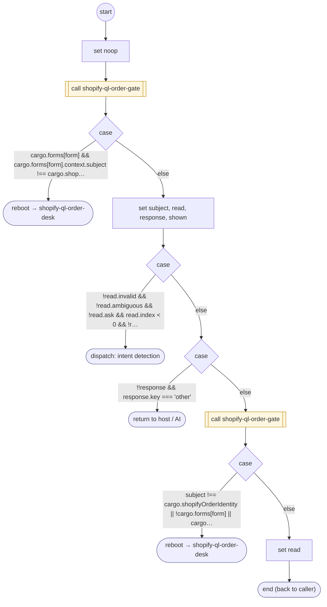

# ShopifyQLOrderReplyCheck

<!-- generated:start -->
**ShopifyQLOrderReplyCheck** · `shopify-ql-order-reply-check` · version 3.0.0 · worker (called by other flows) · steps · isolated scope

> Read a contextual order question or selection, using typed semantic continuation only when local field ownership cannot decide. A question about the order that its status, delivery, tracking and items cannot answer (a refund, cancellation, change or complaint) is picked as `other` by the reply ranker and returns '' so the Guru answers from the tenant's knowledge (owner 2026-11-19; prod 15:27 'If it doesn't arrive today can I get my money back?' was given the delivery line a third time). An apology like the Curacao account menu's (account-unanswerable) is the alternative, to be decided from how this works.

- **Parameters:** 
  - `value`: Original order question or selection
  - `form`: Owning FORM instance
- **Calls:** [shopify-ql-order-gate](shopify-ql-order-gate.md) (call), [shopify-ql-order-desk](shopify-ql-order-desk.md) (reboot), [shopify-ql-order-question](shopify-ql-order-question.md) (call)
- **Tools:** none
- **Called by:** [shopify-ql-order-question](shopify-ql-order-question.md) (validator)

### Steps

<!-- generated:end -->
