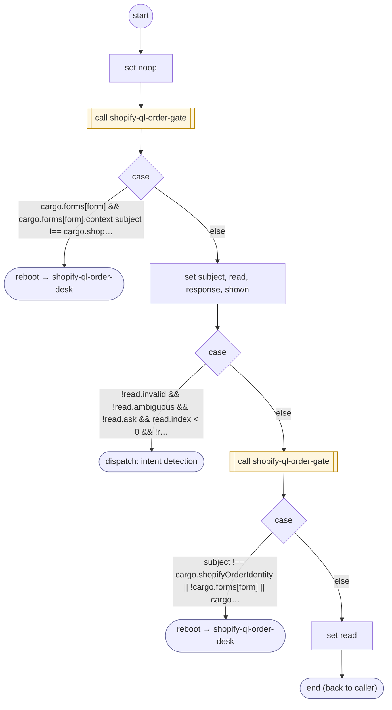

# ShopifyQLOrderReplyCheck

<!-- generated:start -->
**ShopifyQLOrderReplyCheck** · `shopify-ql-order-reply-check` · version 3.0.0 · worker (called by other flows) · steps · isolated scope

> Read a contextual order question or selection, using typed semantic continuation only when local field ownership cannot decide.

- **Parameters:** 
  - `value`: Original order question or selection
  - `form`: Owning FORM instance
- **Calls:** [shopify-ql-order-gate](shopify-ql-order-gate.md) (call), [shopify-ql-order-desk](shopify-ql-order-desk.md) (reboot), [shopify-ql-order-question](shopify-ql-order-question.md) (call)
- **Tools:** none
- **Called by:** [shopify-ql-order-question](shopify-ql-order-question.md) (validator)

### Steps

<!-- generated:end -->
