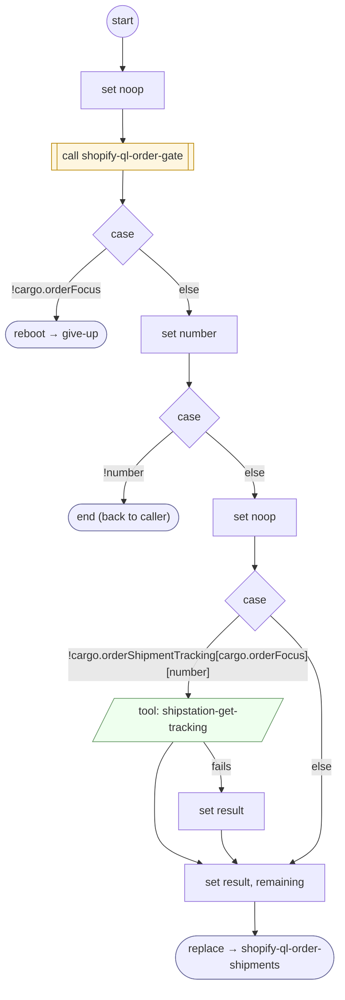

# ShopifyQLOrderShipments

<!-- generated:start -->
**ShopifyQLOrderShipments** · `shopify-ql-order-shipments` · version 3.0.0 · worker (called by other flows) · steps · isolated scope

> Retrieve each distinct package tracking number once under the already verified focused order; preserve per-package fallback.

- **Parameters:** 
  - `numbers`: Distinct carrier numbers
- **Calls:** [shopify-ql-order-gate](shopify-ql-order-gate.md) (call), [give-up](../system/give-up.md) (system) (reboot), [shopify-ql-order-shipments](shopify-ql-order-shipments.md) (replace)
- **Tools:** `shipstation-get-tracking`
- **Called by:** [shopify-ql-order-shipments](shopify-ql-order-shipments.md), [shopify-ql-order-carriers](shopify-ql-order-carriers.md)

### Steps

<!-- generated:end -->
