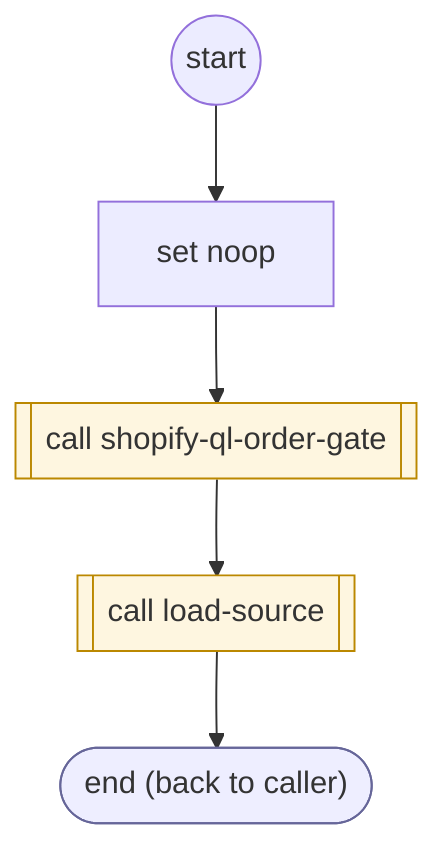

# ShopifyQLOrdersFetch

<!-- generated:start -->
**ShopifyQLOrdersFetch** · `shopify-ql-orders-fetch` · version 3.0.0 · worker (called by other flows) · steps · isolated scope

> Load the verified customer orders through the shared subject-scoped source lifecycle.

- **Parameters:** none
- **Calls:** [shopify-ql-orders-load](shopify-ql-orders-load.md) (call), [shopify-ql-order-gate](shopify-ql-order-gate.md) (call), [load-source](../system/load-source.md) (system) (call)
- **Tools:** none
- **Called by:** [shopify-ql-order-desk](shopify-ql-order-desk.md)

### Steps

<!-- generated:end -->
