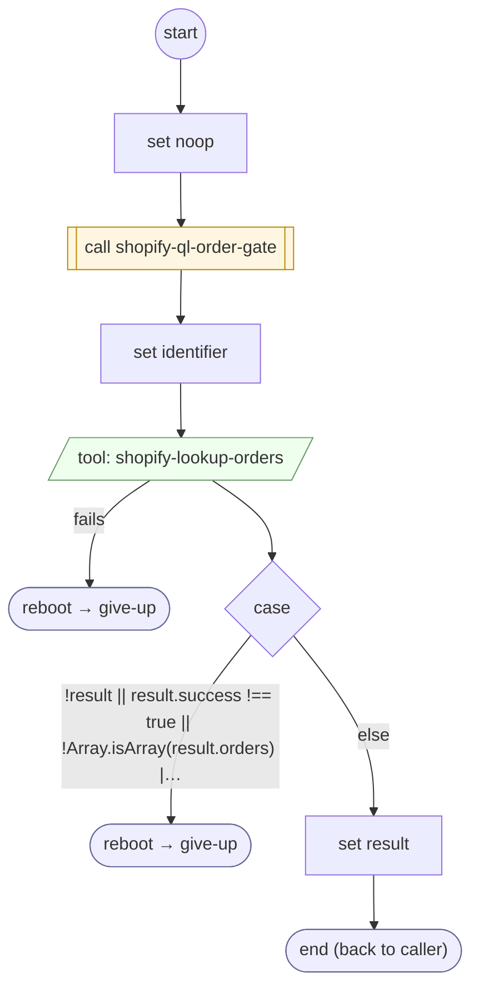

# ShopifyQLOrdersLoad

<!-- generated:start -->
**ShopifyQLOrdersLoad** · `shopify-ql-orders-load` · version 3.0.0 · worker (called by other flows) · steps · isolated scope

> Retrieve orders for exactly the verified email or phone; a different proposed customer provides no orders.

- **Parameters:** none
- **Calls:** [shopify-ql-order-gate](shopify-ql-order-gate.md) (call), [give-up](../system/give-up.md) (system) (reboot)
- **Tools:** `shopify-lookup-orders`
- **Called by:** [shopify-ql-orders-fetch](shopify-ql-orders-fetch.md)

### Steps

<!-- generated:end -->
