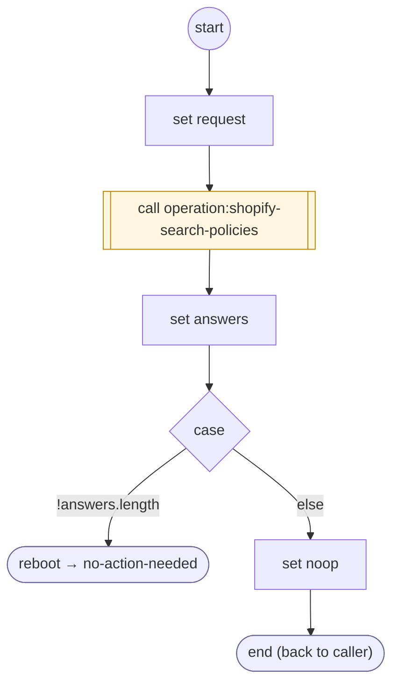

# ShopifyQLPoliciesLoad

<!-- generated:start -->
**ShopifyQLPoliciesLoad** · `shopify-ql-policies-load` · version 3.0.0 · worker (called by other flows) · steps · isolated scope

> Retrieve policy matches for the current question; only nonempty textual FAQ answers can become provider evidence.

- **Parameters:** none
- **Calls:** [operation:shopify-search-policies](operation:shopify-search-policies.md) (call), [no-action-needed](../system/no-action-needed.md) (system) (reboot)
- **Tools:** none
- **Called by:** [shopify-ql-store-policies](shopify-ql-store-policies.md)

### Steps

<!-- generated:end -->
