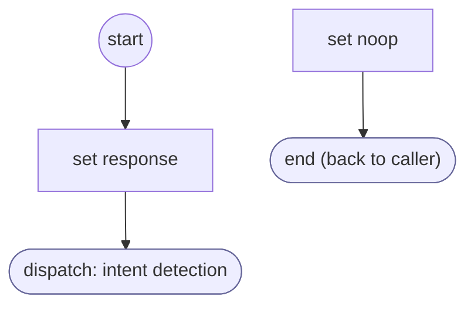

# ShopifyQLPolicyQuestionValidate

<!-- generated:start -->
**ShopifyQLPolicyQuestionValidate** · `shopify-ql-policy-question-validate` · version 3.0.0 · worker (called by other flows) · steps · isolated scope

> Classify a proposed policy question before accepting it; preserve the live collector when it remains a policy response.

- **Parameters:** 
  - `value`: Candidate policy question
  - `form`: Owning policy question form
- **Calls:** [shopify-ql-policy-question](shopify-ql-policy-question.md) (call)
- **Tools:** none
- **Called by:** [shopify-ql-policy-question](shopify-ql-policy-question.md) (validator)

### Steps

<!-- generated:end -->
