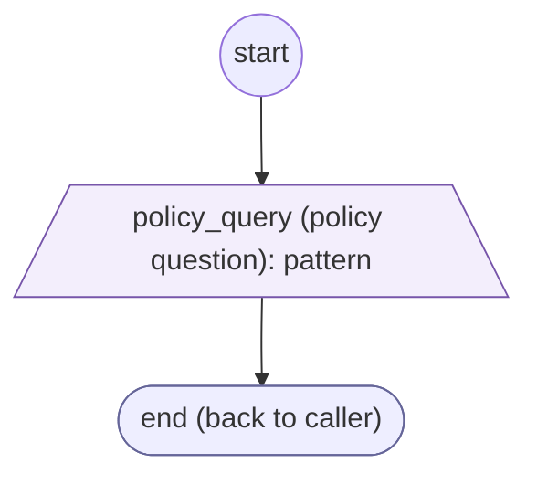
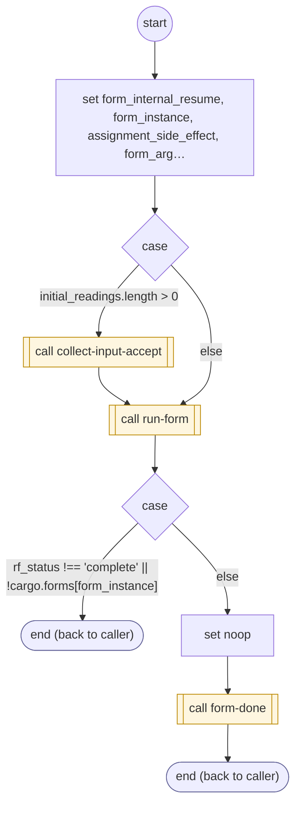

# ShopifyQLPolicyQuestion

<!-- generated:start -->
**ShopifyQLPolicyQuestion** · `shopify-ql-policy-question` · version 3.0.0 · worker (called by other flows) · form + steps · isolated scope

> Collect the policy question as spoken; the generic collector owns agent, exit, retry and resumable yield behavior.

- **Parameters:** 
  - `form_instance`: Internal instance to resume
- **Calls:** [shopify-ql-policy-question-validate](shopify-ql-policy-question-validate.md) (validator), [collect-input-accept](../system/collect-input-accept.md) (system) (call), [run-form](../system/run-form.md) (system) (call), [form-done](../system/form-done.md) (system) (call)
- **Tools:** none
- **Called by:** [shopify-ql-store-policies](shopify-ql-store-policies.md), [shopify-ql-policy-question-validate](shopify-ql-policy-question-validate.md)

### Form inputs

### Steps

<!-- generated:end -->
