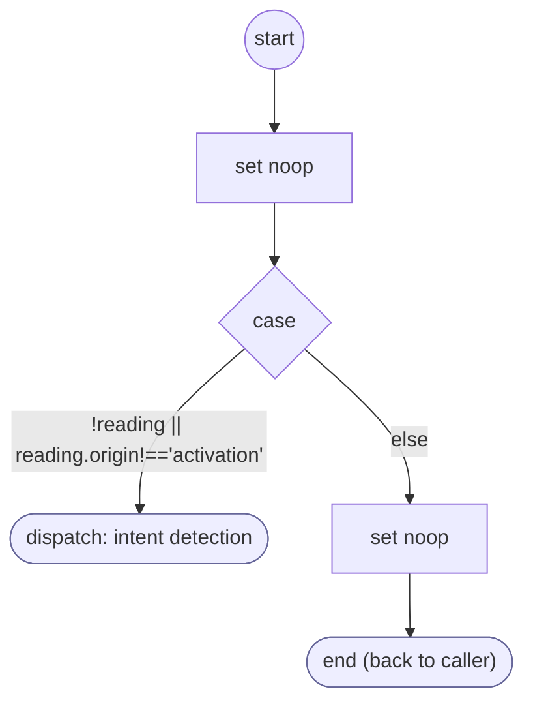

# ShopifyQLProductCityValidate

<!-- generated:start -->
**ShopifyQLProductCityValidate** · `shopify-ql-product-city-validate` · version 3.0.0 · worker (called by other flows) · steps · isolated scope

> Classify a candidate place before accepting it or requesting inventory.

- **Parameters:** 
  - `value`: Candidate location
  - `form`: Owning form
  - `reading`: FORM reading and activation provenance
- **Calls:** no other flow
- **Tools:** none
- **Called by:** [shopify-ql-product-stores](shopify-ql-product-stores.md) (validator), [shopify-ql-product-location-retry](shopify-ql-product-location-retry.md) (validator)

### Steps

<!-- generated:end -->
