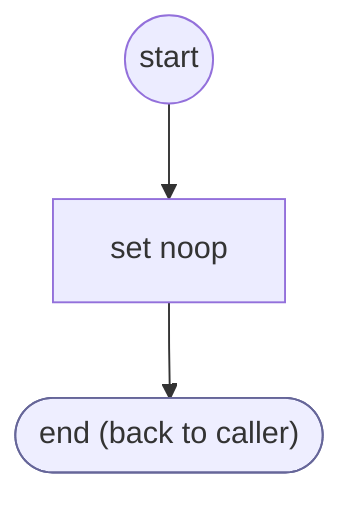

# ShopifyQLProductDialogPrepare

<!-- generated:start -->
**ShopifyQLProductDialogPrepare** · `shopify-ql-product-dialog-prepare` · version 3.0.0 · worker (called by other flows) · steps · isolated scope

> Offer only supported store and text actions for this channel.

- **Parameters:** 
  - `form`: Owning form
- **Calls:** no other flow
- **Tools:** none
- **Called by:** [shopify-ql-product-dialog](shopify-ql-product-dialog.md) (prepare)

### Steps

<!-- generated:end -->
