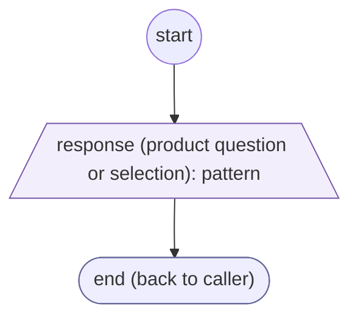
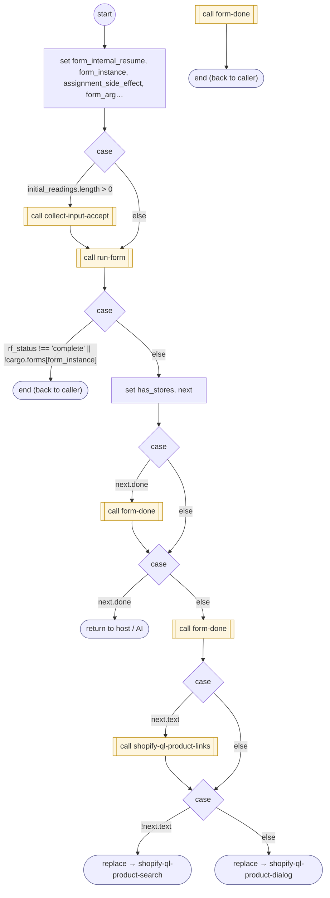

# ShopifyQLProductDialog

<!-- generated:start -->
**ShopifyQLProductDialog** · `shopify-ql-product-dialog` · version 3.0.0 · worker (called by other flows) · form + steps · isolated scope

> Collect the next question about shown products; unknown requests yield through the shared FORM contract.

- **Parameters:** 
  - `completion`: Outcome already presented before this optional follow-up
  - `form_instance`: Internal instance to resume
- **Calls:** [shopify-ql-product-dialog-prepare](shopify-ql-product-dialog-prepare.md) (prepare), [shopify-ql-product-dialog-validate](shopify-ql-product-dialog-validate.md) (validator), [collect-input-accept](../system/collect-input-accept.md) (system) (call), [run-form](../system/run-form.md) (system) (call), [form-done](../system/form-done.md) (system) (call), [shopify-ql-product-links](shopify-ql-product-links.md) (call), [shopify-ql-product-search](shopify-ql-product-search.md) (replace), [shopify-ql-product-dialog](shopify-ql-product-dialog.md) (replace)
- **Tools:** none
- **Called by:** [shopify-ql-product-search](shopify-ql-product-search.md), [shopify-ql-products-fetch](shopify-ql-products-fetch.md) (by name), [shopify-ql-product-dialog](shopify-ql-product-dialog.md)

### Form inputs

### Steps

<!-- generated:end -->
