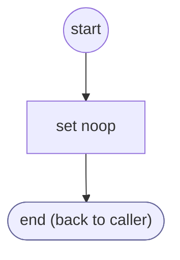

# ShopifyQLProductFactsLoad

<!-- generated:start -->
**ShopifyQLProductFactsLoad** · `shopify-ql-product-facts-load` · version 3.0.0 · worker (called by other flows) · steps · isolated scope

> Project only supported facts from the result list actually shown; keep ordinal positions stable.

- **Parameters:** none
- **Calls:** no other flow
- **Tools:** none
- **Called by:** [shopify-ql-product-search](shopify-ql-product-search.md)

### Steps

<!-- generated:end -->
