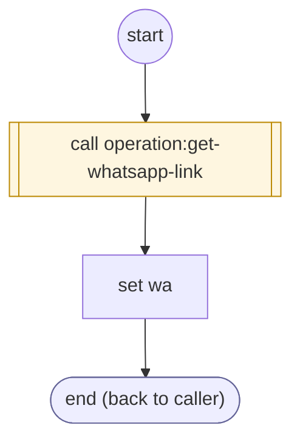

# ShopifyQLProductLinksPrepare

<!-- generated:start -->
**ShopifyQLProductLinksPrepare** · `shopify-ql-product-links-prepare` · version 3.0.0 · worker (called by other flows) · steps · isolated scope

> Prepare links for exactly the products the channel showed, without including unoffered results.

- **Parameters:** 
  - `form`: Owning delivery form
- **Calls:** [operation:get-whatsapp-link](operation:get-whatsapp-link.md) (call)
- **Tools:** none
- **Called by:** [shopify-ql-product-links](shopify-ql-product-links.md) (prepares)

### Steps

<!-- generated:end -->
