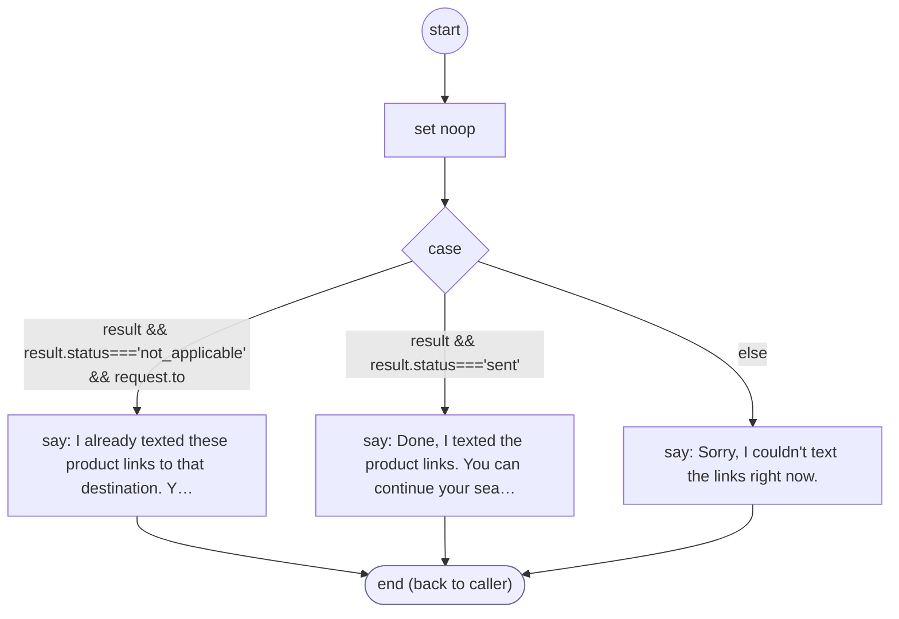

# ShopifyQLProductLinksPresent

<!-- generated:start -->
**ShopifyQLProductLinksPresent** · `shopify-ql-product-links-present` · version 3.0.0 · worker (called by other flows) · steps · isolated scope

> Report link delivery only from the guarded send result.

- **Parameters:** 
  - `result`: Action result
  - `request`: Prepared delivery
- **Calls:** no other flow
- **Tools:** none
- **Called by:** [shopify-ql-product-links](shopify-ql-product-links.md) (presents)

### Steps

<!-- generated:end -->
