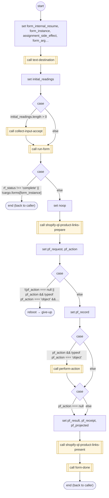

# ShopifyQLProductLinks

<!-- generated:start -->
**ShopifyQLProductLinks** · `shopify-ql-product-links` · version 3.0.0 · worker (called by other flows) · form + steps · isolated scope

> Send only the product links shown, to the explicitly resolved text destination, after a TEXT request.

- **Parameters:** 
  - `form_instance`: Internal instance to resume
- **Calls:** [send-text-action](../system/send-text-action.md) (system) (call), [shopify-ql-product-links-prepare](shopify-ql-product-links-prepare.md) (prepares, call), [shopify-ql-product-links-present](shopify-ql-product-links-present.md) (presents, call), [text-destination](../system/text-destination.md) (system) (call), [collect-input-accept](../system/collect-input-accept.md) (system) (call), [run-form](../system/run-form.md) (system) (call), [give-up](../system/give-up.md) (system) (reboot), [perform-action](../system/perform-action.md) (system) (call), [form-done](../system/form-done.md) (system) (call)
- **Tools:** none
- **Called by:** [shopify-ql-product-dialog](shopify-ql-product-dialog.md)

### Steps

<!-- generated:end -->
