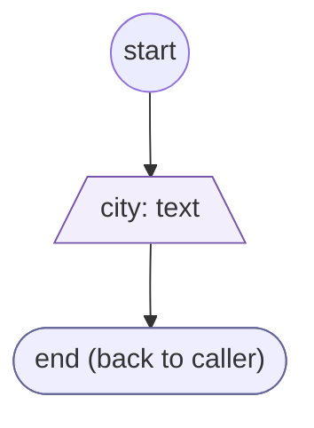
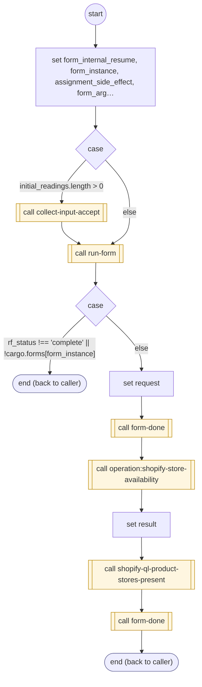

# ShopifyQLProductLocationRetry

<!-- generated:start -->
**ShopifyQLProductLocationRetry** · `shopify-ql-product-location-retry` · version 3.0.0 · worker (called by other flows) · form + steps · isolated scope

> Ask once for a corrected city or ZIP after a geocoding miss.

- **Parameters:** 
  - `variant`: Chosen variant
  - `form_instance`: Internal instance to resume
- **Calls:** [shopify-ql-product-city-validate](shopify-ql-product-city-validate.md) (validator), [collect-input-accept](../system/collect-input-accept.md) (system) (call), [run-form](../system/run-form.md) (system) (call), [form-done](../system/form-done.md) (system) (call), [operation:shopify-store-availability](operation:shopify-store-availability.md) (call), [shopify-ql-product-stores-present](shopify-ql-product-stores-present.md) (call)
- **Tools:** none
- **Called by:** [shopify-ql-products-fetch](shopify-ql-products-fetch.md) (by name), [shopify-ql-product-stores](shopify-ql-product-stores.md)

### Form inputs

### Steps

<!-- generated:end -->
