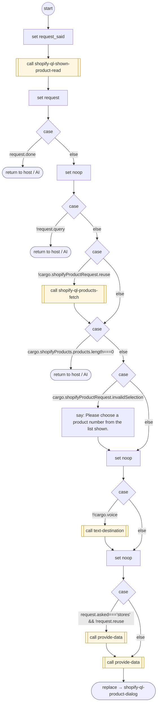

# ShopifyQLProductSearch

<!-- generated:start -->
**ShopifyQLProductSearch** · `shopify-ql-product-search` · version 3.0.0 · **entry point** (intent detection can start it) · steps · isolated scope

> Wants to find, price or check availability of a product, including one named alone ('tires') or on sale ('¿tienen televisores en oferta?'); wants to place a new order ('quiero hacer un pedido de un televisor', 'I want to order a TV'); or asks about the products shown. Not: sales, specials, deals or promotions in general ('¿qué especiales tienen para Black Friday?') with no product named (None); 'I have an order for X', 'I placed an order for X', 'tengo un pedido de X' or 'hice un pedido de X', whatever X is: that order already exists, so it is order tracking, never a search; when a product will be restocked (None); store policies; interest, APR or financing terms, advice or greetings (None).

- **Parameters:** 
  - `search_query`: Product type, brand and features named by the caller, in the original language. Extract the product phrase from a question asking whether it is sold, its price or availability. Leave unset only when no product is named, such as a greeting or a reference to prior results; put changed constraints on prior products in refinement.
  - `refinement`: Changed color, size, budget or features for products previously shown, such as in white or under 200 dollars. Leave search_query empty when the caller refers to prior products rather than naming a new product.
  - `user_city`: City and state, state, ZIP, or store location explicitly named
  - `product_number`: Position among the products last shown, 1 through 3 on voice or 1 through 5 in text
  - `refresh`: True only for an explicit request to refresh online product availability
  - `asked` (results / stock / price / cheapest / details / stores): results: Find products or show the previously shown products. stock: Which of the shown products are in stock online; not physical store inventory. price: Prices of shown products or a selected product. cheapest: Cheapest among the products shown, not a claim about the entire catalog. details: Details of a listed product. stores: Stores near a city/state/ZIP with the selected product variant in stock
- **Calls:** [shopify-ql-product-facts-load](shopify-ql-product-facts-load.md) (call), [shopify-ql-product-stores](shopify-ql-product-stores.md) (call), [shopify-ql-shown-product-read](shopify-ql-shown-product-read.md) (call), [shopify-ql-products-fetch](shopify-ql-products-fetch.md) (call), [text-destination](../system/text-destination.md) (system) (call), [provide-data](../system/provide-data.md) (system) (call), [shopify-ql-product-dialog](shopify-ql-product-dialog.md) (replace)
- **Tools:** none
- **Called by:** intent detection, [shopify-ql-product-dialog](shopify-ql-product-dialog.md)

### Steps

<!-- generated:end -->
