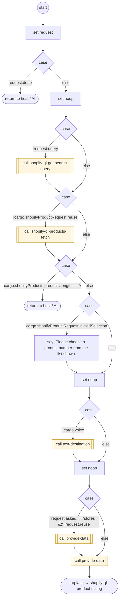

# ShopifyQLProductSearch

<!-- generated:start -->
**ShopifyQLProductSearch** · `shopify-ql-product-search` · version 3.0.0 · **entry point** (intent detection can start it) · steps · isolated scope

> Find a product, price, or online/store availability, including a product named alone ('a Minions costume', 'tires'). Follow-up questions about those products, which are in stock, their price, the second one, or the cheapest use the shown-result context. Extract a new search_query only when the caller names a new product or changed features. Explicit variant or color changes are a new search, not permission to drop those constraints. Store availability requires a chosen product and city/state/ZIP. Not placed orders (ShopifyQLTrackOrder), policies (ShopifyQLStorePolicies), advice or greetings (None); the interest, APR or financing terms of buying on credit ('¿cuánto de interés?', 'what is the interest rate') (None).

- **Parameters:** 
  - `search_query`: Product type, brand and features named by the caller, in the original language. Extract the product phrase from a question asking whether it is sold, its price or availability. Leave unset only when no product is named, such as a greeting or a reference to prior results; put changed constraints on prior products in refinement.
  - `refinement`: Changed color, size, budget or features for products previously shown, such as in white or under 200 dollars. Leave search_query empty when the caller refers to prior products rather than naming a new product.
  - `user_city`: City and state, state, ZIP, or store location explicitly named
  - `product_number`: Position among the products last shown, 1 through 3 on voice or 1 through 5 in text
  - `refresh`: True only for an explicit request to refresh online product availability
  - `asked` (results / stock / price / cheapest / details / stores): results: Find products or show the previously shown products. stock: Which of the shown products are in stock online; not physical store inventory. price: Prices of shown products or a selected product. cheapest: Cheapest among the products shown, not a claim about the entire catalog. details: Details of a listed product. stores: Stores near a city/state/ZIP with the selected product variant in stock
- **Calls:** [shopify-ql-product-facts-load](shopify-ql-product-facts-load.md) (call), [shopify-ql-product-stores](shopify-ql-product-stores.md) (call), [shopify-ql-get-search-query](shopify-ql-get-search-query.md) (call), [shopify-ql-products-fetch](shopify-ql-products-fetch.md) (call), [text-destination](../system/text-destination.md) (system) (call), [provide-data](../system/provide-data.md) (system) (call), [shopify-ql-product-dialog](shopify-ql-product-dialog.md) (replace)
- **Tools:** none
- **Called by:** intent detection, [shopify-ql-product-dialog](shopify-ql-product-dialog.md)

### Steps

<!-- generated:end -->
