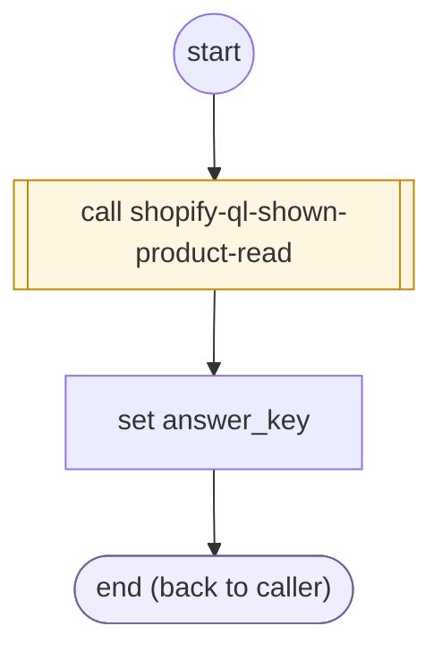

# ShopifyQLProductSelectionAnswer

<!-- generated:start -->
**ShopifyQLProductSelectionAnswer** · `shopify-ql-product-selection-answer` · version 3.0.0 · worker (called by other flows) · steps · shared scope

> ask-choice's answer_validator at the store product question: an answer the keys did not read is read by the shown-product reader, and a product it names is the answer's key (answer_key); anything else goes on to the reply ranker.

- **Parameters:** 
  - `answer`: The caller's answer
- **Calls:** [shopify-ql-shown-product-read](shopify-ql-shown-product-read.md) (call)
- **Tools:** none
- **Called by:** [shopify-ql-product-stores](shopify-ql-product-stores.md) (answer_validator)

### Steps

<!-- generated:end -->
