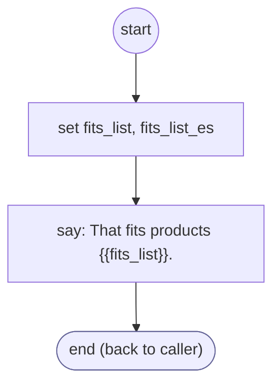

# ShopifyQLProductSelectionFits

<!-- generated:start -->
**ShopifyQLProductSelectionFits** · `shopify-ql-product-selection-fits` · version 3.0.0 · worker (called by other flows) · steps · isolated scope

> route_keys handler at the store product question: the answer fits several shown products (key fits:<numbers>); says which, counts an attempt, and the form asks the question again.

- **Parameters:** 
  - `form`: Owning form
  - `input`: The asked input
- **Calls:** no other flow
- **Tools:** none
- **Called by:** [shopify-ql-product-stores](shopify-ql-product-stores.md)

### Steps

<!-- generated:end -->
