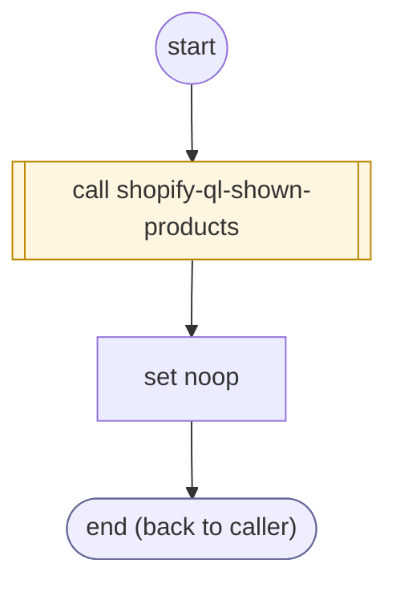

# ShopifyQLProductSelectionPrepare

<!-- generated:start -->
**ShopifyQLProductSelectionPrepare** · `shopify-ql-product-selection-prepare` · version 3.0.0 · worker (called by other flows) · steps · isolated scope

> Offer only the product positions the channel actually showed, each labelled with every attribute the product carries (shopify-ql-shown-products: title, brand, option values, the price the list reads) so the reply ranker can match any of them.

- **Parameters:** 
  - `form`: Owning form
- **Calls:** [shopify-ql-shown-products](shopify-ql-shown-products.md) (call)
- **Tools:** none
- **Called by:** [shopify-ql-product-stores](shopify-ql-product-stores.md) (prepare)

### Steps

<!-- generated:end -->
