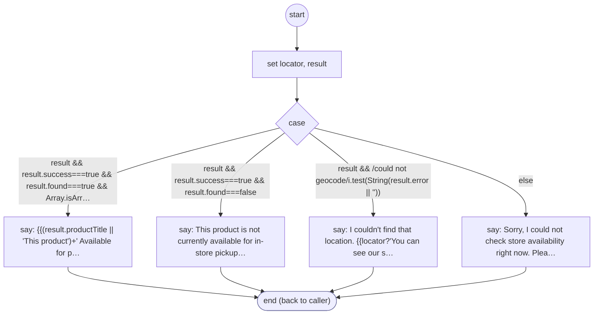

# ShopifyQLProductStoresPresent

<!-- generated:start -->
**ShopifyQLProductStoresPresent** · `shopify-ql-product-stores-present` · version 3.0.0 · worker (called by other flows) · steps · isolated scope

> Present live store inventory without fabricating locations, quantities or geocoding success.

- **Parameters:** 
  - `result`: Store result
- **Calls:** no other flow
- **Tools:** none
- **Called by:** [shopify-ql-product-stores](shopify-ql-product-stores.md), [shopify-ql-product-location-retry](shopify-ql-product-location-retry.md)

### Steps

<!-- generated:end -->
