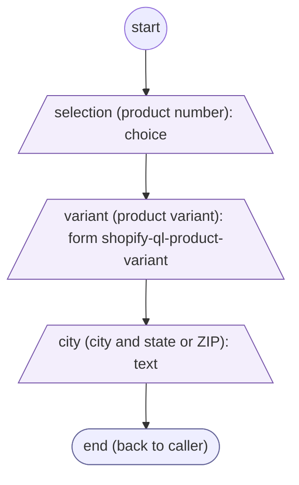

# ShopifyQLProductStores

<!-- generated:start -->
**ShopifyQLProductStores** · `shopify-ql-product-stores` · version 3.0.0 · worker (called by other flows) · form + steps · isolated scope

> Collect the listed product and nearby city/state/ZIP, then retrieve live store inventory for its variant.

- **Parameters:** 
  - `selection`: Product position already accepted
  - `city`: Place already supplied
  - `form_instance`: Internal instance to resume
- **Calls:** [shopify-ql-product-selection-prepare](shopify-ql-product-selection-prepare.md) (prepare), [shopify-ql-product-variant](shopify-ql-product-variant.md) (sub-form, definition), [shopify-ql-product-city-validate](shopify-ql-product-city-validate.md) (validator), [form-done](../system/form-done.md) (system) (call), [collect-input-accept](../system/collect-input-accept.md) (system) (call), [run-form](../system/run-form.md) (system) (call), [operation:shopify-store-availability](operation:shopify-store-availability.md) (call), [shopify-ql-product-location-retry](shopify-ql-product-location-retry.md) (call), [shopify-ql-product-stores-present](shopify-ql-product-stores-present.md) (call)
- **Tools:** none
- **Called by:** [shopify-ql-product-search](shopify-ql-product-search.md), [shopify-ql-products-fetch](shopify-ql-products-fetch.md) (by name)

### Form inputs

### Steps

```mermaid
flowchart TD
   START(("start"))
   n0["set form_internal_resume, form_instance, assignment_side_effect, form_arg…"]
   START --> n0
   c1{"case"}
   n0 --> c1
   b2[["call form-done"]]
   class b2 flowstep
   c1 -- "!(typeof global_store_locations!=='undefined' && Array.isArray(global…" --> b2
   c3{"case"}
   b2 --> c3
   c1 -- "else" --> c3
   b4(["return to host / AI"])
   class b4 endstep
   c3 -- "!(typeof global_store_locations!=='undefined' && Array.isArray(global…" --> b4
   n5["set selection, city, initial_readings"]
   c3 -- "else" --> n5
   c6{"case"}
   n5 --> c6
   b7[["call collect-input-accept"]]
   class b7 flowstep
   c6 -- "initial_readings.length #gt; 0" --> b7
   n8[["call run-form"]]
   class n8 flowstep
   b7 --> n8
   c6 -- "else" --> n8
   c9{"case"}
   n8 --> c9
   b10(["end (back to caller)"])
   class b10 endstep
   c9 -- "rf_status !== 'complete' #124;#124; !cargo.forms[form_instance]" --> b10
   n11["set variant"]
   c9 -- "else" --> n11
   c12{"case"}
   n11 --> c12
   b13[["call form-done"]]
   class b13 flowstep
   c12 -- "!variant" --> b13
   c14{"case"}
   b13 --> c14
   c12 -- "else" --> c14
   b15(["return to host / AI"])
   class b15 endstep
   c14 -- "!variant" --> b15
   n16["set request"]
   c14 -- "else" --> n16
   n17[["call form-done"]]
   class n17 flowstep
   n16 --> n17
   n18[["call operation:shopify-store-availability"]]
   class n18 flowstep
   n17 --> n18
   n19["set result"]
   n18 --> n19
   c20{"case"}
   n19 --> c20
   b21[["call shopify-ql-product-location-retry"]]
   class b21 flowstep
   c20 -- "result && result.success===false && /could not geocode/i.test(String(…" --> b21
   c22{"case"}
   b21 --> c22
   c20 -- "else" --> c22
   b23[["call shopify-ql-product-stores-present"]]
   class b23 flowstep
   c22 -- "!(result && result.success===false && /could not geocode/i.test(Strin…" --> b23
   n24[["call form-done"]]
   class n24 flowstep
   b23 --> n24
   c22 -- "else" --> n24
   DONE(["end (back to caller)"])
   class DONE endstep
   n24 --> DONE
   classDef endstep fill:#eef,stroke:#669
   classDef toolstep fill:#efe,stroke:#696
   classDef flowstep fill:#fef6e0,stroke:#b80
   classDef inputstep fill:#f3eefc,stroke:#75a
```

<!-- generated:end -->
