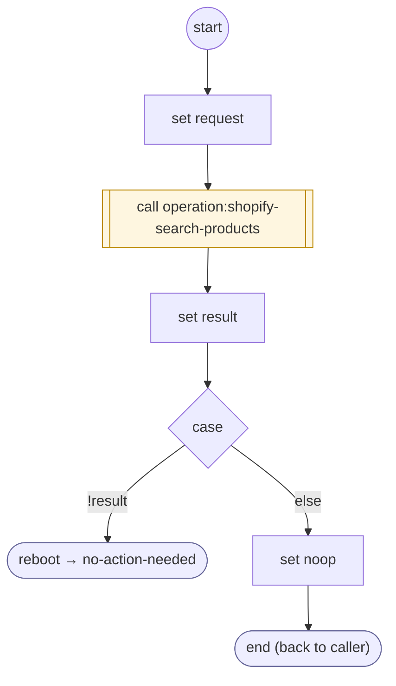

# ShopifyQLProductsFetch

<!-- generated:start -->
**ShopifyQLProductsFetch** · `shopify-ql-products-fetch` · version 3.0.0 · worker (called by other flows) · steps · isolated scope

> Retrieve a new public catalog result and replace the prior context only with a valid response.

- **Parameters:** none
- **Calls:** [operation:shopify-search-products](operation:shopify-search-products.md) (call), [no-action-needed](../system/no-action-needed.md) (system) (reboot), [shopify-ql-get-search-query](shopify-ql-get-search-query.md) (by name), [shopify-ql-product-dialog](shopify-ql-product-dialog.md) (by name), [shopify-ql-product-stores](shopify-ql-product-stores.md) (by name), [shopify-ql-product-location-retry](shopify-ql-product-location-retry.md) (by name)
- **Tools:** none
- **Called by:** [shopify-ql-product-search](shopify-ql-product-search.md)

### Steps

<!-- generated:end -->
