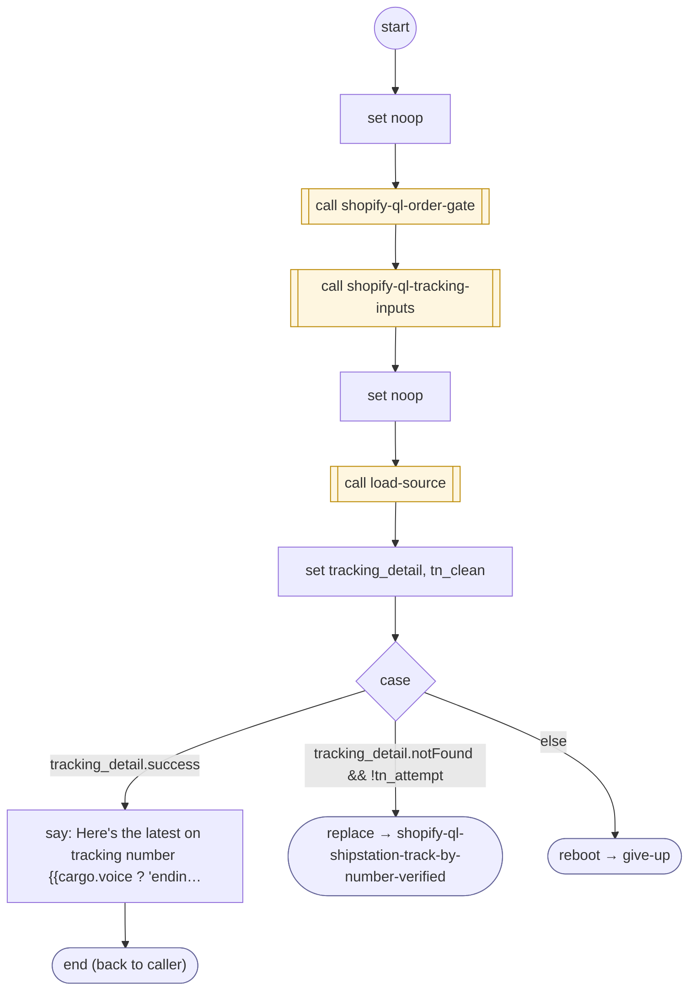

# ShopifyQLShipStationTrackByNumberVerified

<!-- generated:start -->
**ShopifyQLShipStationTrackByNumberVerified** · `shopify-ql-shipstation-track-by-number-verified` · version 3.0.0 · worker (called by other flows) · steps · isolated scope

> Verify the contact, collect a carrier number, retrieve real status and permit one explicit not-found correction.

- **Parameters:** 
  - `tracking_number`: Carrier tracking number
  - `intro_message`: Optional introduction
  - `intro_message_es`: Optional Spanish introduction
  - `tn_attempt`: Internal bounded correction marker
- **Calls:** [shopify-ql-tracking-load](shopify-ql-tracking-load.md) (call), [shopify-ql-order-gate](shopify-ql-order-gate.md) (call), [shopify-ql-tracking-inputs](shopify-ql-tracking-inputs.md) (call), [load-source](../system/load-source.md) (system) (call), [shopify-ql-shipstation-track-by-number-verified](shopify-ql-shipstation-track-by-number-verified.md) (replace), [give-up](../system/give-up.md) (system) (reboot)
- **Tools:** none
- **Called by:** [shopify-ql-track-order](shopify-ql-track-order.md), [shopify-ql-no-orders](shopify-ql-no-orders.md), [shopify-ql-shipstation-track-by-number-verified](shopify-ql-shipstation-track-by-number-verified.md)

### Steps

<!-- generated:end -->
