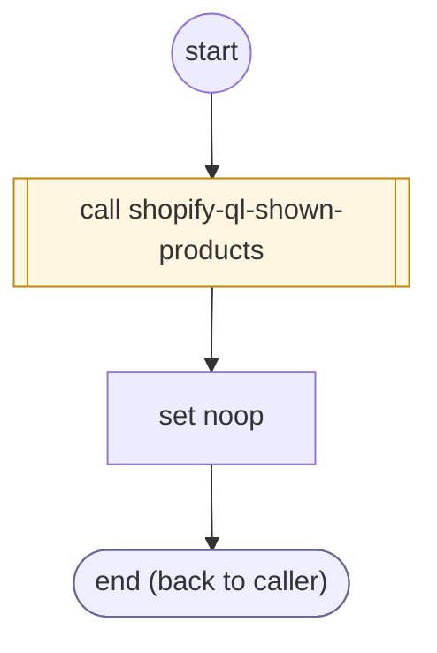

# ShopifyQLShownProductRead

<!-- generated:start -->
**ShopifyQLShownProductRead** · `shopify-ql-shown-product-read` · version 3.0.0 · worker (called by other flows) · steps · isolated scope

> The one shown-product reader: a position key at the start, an ordinal, or words of the answer that are all attributes of exactly one shown product (closest title by 0.15), into cargo.shopifyShownRead {answer, selection, fits, conflict}; fits lists the products when every word is an attribute of several. Every other answer is left to the reply ranker.

- **Parameters:** 
  - `answer`: The caller's answer
- **Calls:** [shopify-ql-shown-products](shopify-ql-shown-products.md) (call)
- **Tools:** none
- **Called by:** [shopify-ql-product-search](shopify-ql-product-search.md), [shopify-ql-product-dialog](shopify-ql-product-dialog.md), [shopify-ql-product-selection-answer](shopify-ql-product-selection-answer.md), [shopify-ql-product-dialog-validate](shopify-ql-product-dialog-validate.md)

### Steps

<!-- generated:end -->
