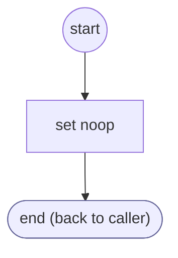

# ShopifyQLShownProducts

<!-- generated:start -->
**ShopifyQLShownProducts** · `shopify-ql-shown-products` · version 3.0.0 · worker (called by other flows) · steps · isolated scope

> The products the channel showed, each with every attribute it carries (title, brand, option values, the price the list reads) and its label for the reply ranker, into cargo.shopifyShown; the one place a listed product is described, for its readers, its labels and the price the list speaks.

- **Parameters:** none
- **Calls:** no other flow
- **Tools:** none
- **Called by:** [shopify-ql-product-facts-load](shopify-ql-product-facts-load.md), [shopify-ql-shown-product-read](shopify-ql-shown-product-read.md), [shopify-ql-product-selection-prepare](shopify-ql-product-selection-prepare.md)

### Steps

<!-- generated:end -->
