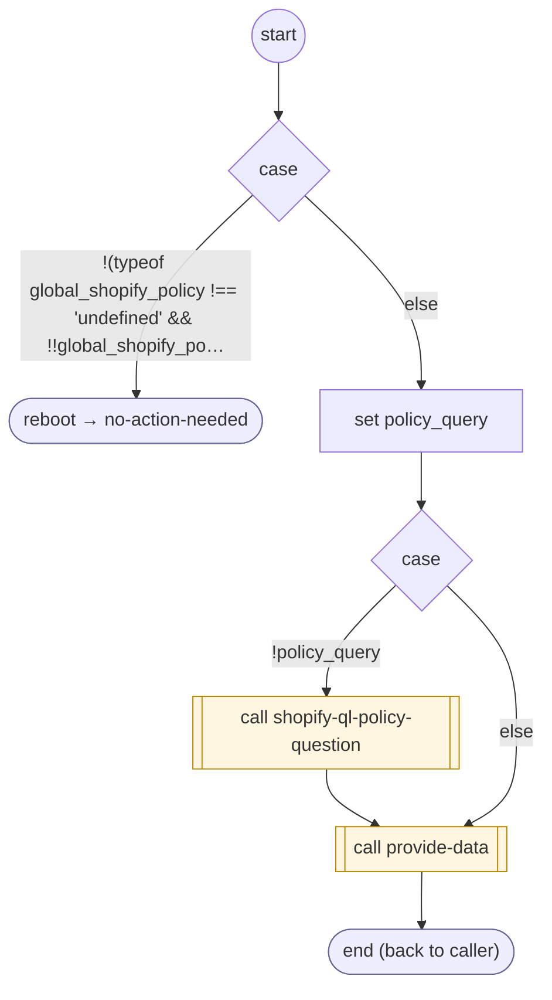

# ShopifyQLStorePolicies

<!-- generated:start -->
**ShopifyQLStorePolicies** · `shopify-ql-store-policies` · version 3.0.0 · **entry point** (intent detection can start it) · steps · isolated scope

> Customer asks about store policy or FAQ terms: returns, refunds, exchanges, shipping or delivery rules ('what is your return policy', 'do you ship to Canada', '¿cuál es su política de devoluciones?'). A policy question concerns general rules; a missing refund on their own purchase, an order already placed, cancellation or a product search belongs to the corresponding task instead. Extract the customer's complete policy question as policy_query; leave it absent when only the policy topic is requested without a question.

- **Parameters:** 
  - `policy_query`: The actual general store policy or FAQ question or topic supplied by the customer, preserving qualifiers such as destination and purchase date. Extract a concrete return, refund, exchange, shipping or other store-rule question/topic. Leave absent for an unknown/unavailable answer, confusion, inability to name a question, or unreadable input; do not turn these into a policy query.
  - `asked` (answer): answer: the store policy or FAQ answer to the customer’s question, including returns, exchanges, refund terms and shipping
- **Calls:** [shopify-ql-policies-load](shopify-ql-policies-load.md) (call), [no-action-needed](../system/no-action-needed.md) (system) (reboot), [shopify-ql-policy-question](shopify-ql-policy-question.md) (call), [provide-data](../system/provide-data.md) (system) (call)
- **Tools:** none
- **Called by:** intent detection

### Steps

<!-- generated:end -->
