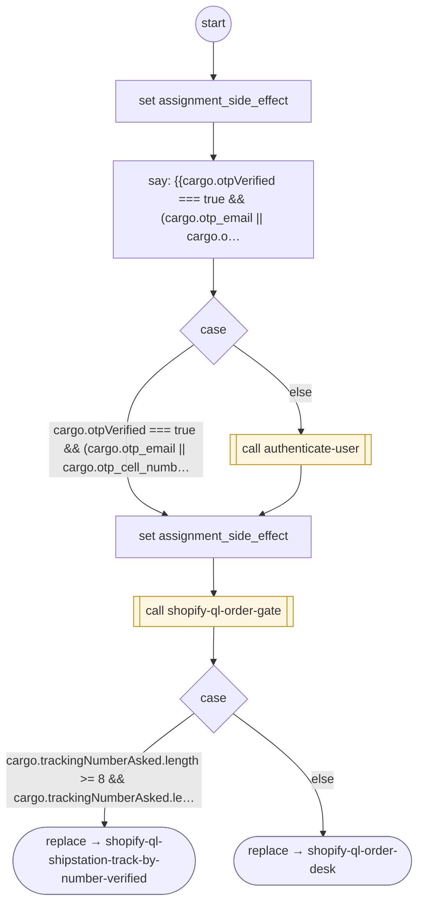

# ShopifyQLTrackOrder

<!-- generated:start -->
**ShopifyQLTrackOrder** · `shopify-ql-track-order` · version 3.0.0 · **entry point** (intent detection can start it) · steps · isolated scope

> Customer asks about an order or purchase they placed, or a package: its status, when it will arrive or be ready for pickup, where it is, its tracking or tracking number, what is in it, a package that has not arrived, or a list of their orders ('where is my order', 'order status', 'my order', 'help with an order', 'track my package', 'when will my delivery arrive', 'order #1234', 'track 1Z999AA10123456784', 'where do I find my tracking number', '¿dónde está mi pedido?', 'mi pedido', 'estado de mi orden', '¿cuándo llega mi pedido?', '¿ya está listo para recoger?', 'no me ha llegado mi pedido', 'rastrear mi pedido', 'rastrear mi paquete'). Not: a charge on their account or bill ('un cargo', 'mi último cargo'), which is not an order; finding a product (ShopifyQLProductSearch); a return, refund or shipping policy (ShopifyQLStorePolicies); cancelling an order (None).

- **Parameters:** 
  - `order_number`: An order number in the message ('#1234', 'S1449567').
  - `tracking_number`: A carrier tracking number in the message (8 to 40 letters and digits, e.g. '1Z999AA10123456784').
  - `caller_name`: Internal: the caller's first name for the opening, from a tenant's thin wrapper (wraps) that looked the caller up first; empty for none.
  - `ask` (track / delivery / items / details / list / pickup): What they want to know: 'track' (where it is, its tracking), 'delivery' (when it arrives, whether it was delivered), 'items' (what is in it), 'details' (its status or details), 'list' (their orders), 'pickup' (a will call or store pickup order); else leave empty.
  - `asked` (track / delivery / items / details): track: where the package is and its tracking. delivery: when the order arrives or was delivered. items: what is in the order. details: order state, total, items and shipping address
  - `no_orders` (return): Internal: 'return' hands a caller with no online orders back to the tenant wrapper that called this flow (cargo.shopifyNoOrders) instead of asking for a tracking number; empty for the default.
- **Calls:** [shopify-ql-order-gate](shopify-ql-order-gate.md) (call), [shopify-ql-order-facts-load](shopify-ql-order-facts-load.md) (call), [authenticate-user](../system/authenticate-user.md) (system) (call), [shopify-ql-track-order](shopify-ql-track-order.md) (retry_flow of authenticate-user), [contact-support](../system/contact-support.md) (system) (cancel_flow of authenticate-user, cancel_flow), [shopify-ql-shipstation-track-by-number-verified](shopify-ql-shipstation-track-by-number-verified.md) (replace), [shopify-ql-order-desk](shopify-ql-order-desk.md) (replace)
- **Tools:** none
- **Called by:** intent detection, [shopify-ql-track-order](shopify-ql-track-order.md) (retry_flow of authenticate-user), [shopify-ql-order-gate](shopify-ql-order-gate.md) (retry_flow of authenticate-user, retry_flow)

### Steps

<!-- generated:end -->
