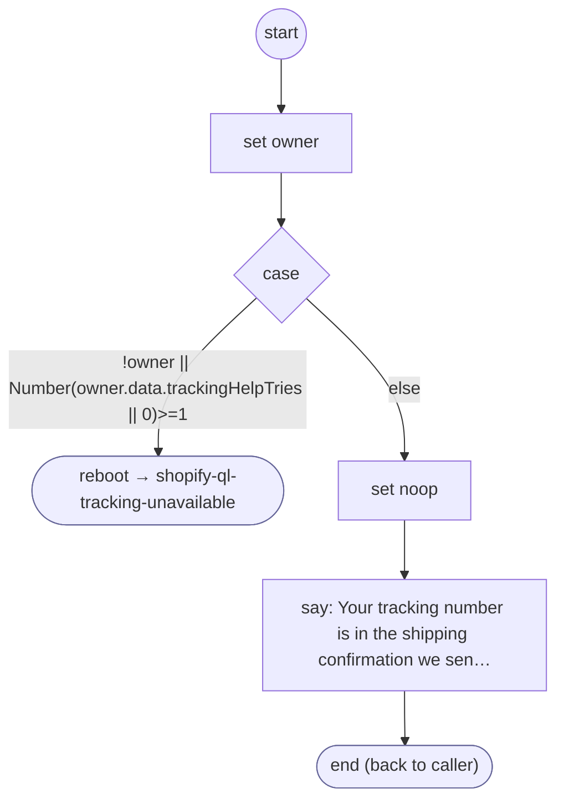

# ShopifyQLTrackingHelp

<!-- generated:start -->
**ShopifyQLTrackingHelp** · `shopify-ql-tracking-help` · version 3.0.0 · worker (called by other flows) · steps · isolated scope

> Explain where a carrier number is found once per owned tracking form, then hand off without an indefinite re-ask.

- **Parameters:** none
- **Calls:** [shopify-ql-tracking-unavailable](shopify-ql-tracking-unavailable.md) (reboot)
- **Tools:** none
- **Called by:** [shopify-ql-tracking-inputs](shopify-ql-tracking-inputs.md)

### Steps

<!-- generated:end -->
