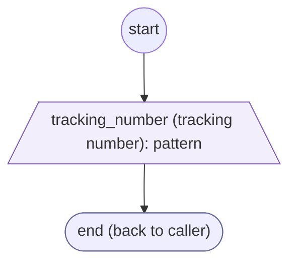
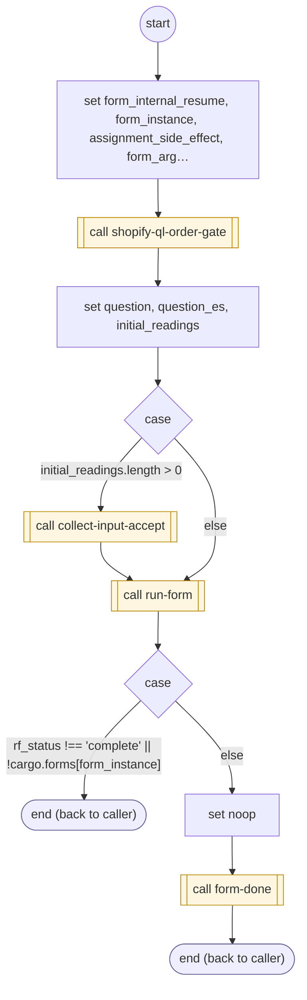

# ShopifyQLTrackingInputs

<!-- generated:start -->
**ShopifyQLTrackingInputs** · `shopify-ql-tracking-inputs` · version 3.0.0 · worker (called by other flows) · form + steps · isolated scope

> Collect a carrier tracking number through generic input matching; answer where to find it before resuming.

- **Parameters:** 
  - `tracking_number`: Tracking number already supplied
  - `intro_message`: English lead-in
  - `intro_message_es`: Spanish lead-in
  - `form_instance`: Internal instance to resume
- **Calls:** [shopify-ql-tracking-number-check](shopify-ql-tracking-number-check.md) (validator), [shopify-ql-tracking-help](shopify-ql-tracking-help.md) (call), [shopify-ql-tracking-unavailable](shopify-ql-tracking-unavailable.md) (call), [shopify-ql-order-gate](shopify-ql-order-gate.md) (call), [collect-input-accept](../system/collect-input-accept.md) (system) (call), [run-form](../system/run-form.md) (system) (call), [form-done](../system/form-done.md) (system) (call)
- **Tools:** none
- **Called by:** [shopify-ql-shipstation-track-by-number-verified](shopify-ql-shipstation-track-by-number-verified.md)

### Form inputs

### Steps

<!-- generated:end -->
