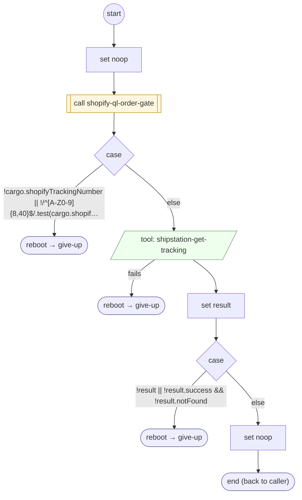

# ShopifyQLTrackingLoad

<!-- generated:start -->
**ShopifyQLTrackingLoad** · `shopify-ql-tracking-load` · version 3.0.0 · worker (called by other flows) · steps · isolated scope

> Retrieve carrier status for an explicitly collected number; no inferred delivery state.

- **Parameters:** none
- **Calls:** [shopify-ql-order-gate](shopify-ql-order-gate.md) (call), [give-up](../system/give-up.md) (system) (reboot)
- **Tools:** `shipstation-get-tracking`
- **Called by:** [shopify-ql-shipstation-track-by-number-verified](shopify-ql-shipstation-track-by-number-verified.md)

### Steps

<!-- generated:end -->
