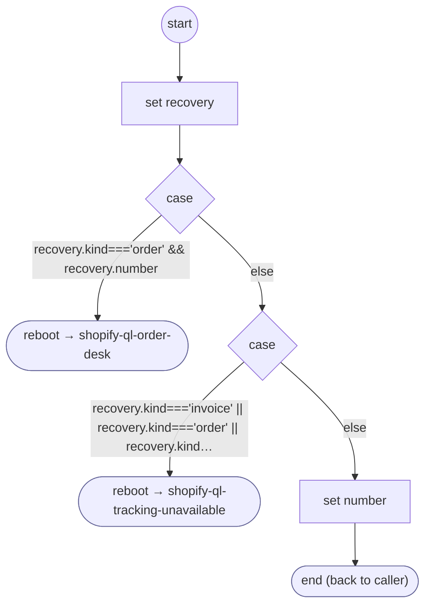

# ShopifyQLTrackingNumberCheck

<!-- generated:start -->
**ShopifyQLTrackingNumberCheck** · `shopify-ql-tracking-number-check` · version 3.0.0 · worker (called by other flows) · steps · isolated scope

> Normalize a complete carrier identifier without joining arbitrary spoken words into a false number.

- **Parameters:** 
  - `value`: Carrier number
  - `reading`: Original input reading
- **Calls:** [shopify-ql-order-desk](shopify-ql-order-desk.md) (reboot), [shopify-ql-tracking-unavailable](shopify-ql-tracking-unavailable.md) (reboot)
- **Tools:** none
- **Called by:** [shopify-ql-tracking-inputs](shopify-ql-tracking-inputs.md) (validator)

### Steps

<!-- generated:end -->
