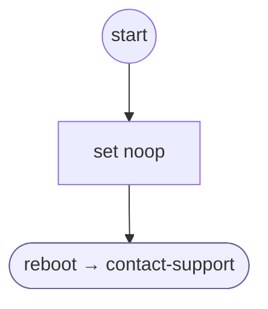

# ShopifyQLTrackingUnavailable

<!-- generated:start -->
**ShopifyQLTrackingUnavailable** · `shopify-ql-tracking-unavailable` · version 3.0.0 · worker (called by other flows) · steps · isolated scope

> End an unavailable tracking exchange with the configured support contact; never invent a delivery date.

- **Parameters:** none
- **Calls:** [contact-support](../system/contact-support.md) (system) (reboot)
- **Tools:** none
- **Called by:** [shopify-ql-tracking-help](shopify-ql-tracking-help.md), [shopify-ql-tracking-inputs](shopify-ql-tracking-inputs.md), [shopify-ql-tracking-number-check](shopify-ql-tracking-number-check.md)

### Steps

<!-- generated:end -->
