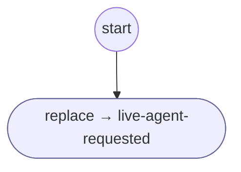

# Keypad0

<!-- generated:start -->
**Keypad0** · `0` · version 1.0.0 · worker (called by other flows) · steps

> Worker: the keypad key 0 when no question took it (no flow running, or a question passed it on with DISPATCH): matched by id, with no AI. A request for a person (the operator reflex), handled once here, not at every question (owner 2026-10-17).

- **Parameters:** none
- **Calls:** [live-agent-requested](live-agent-requested.md) (replace)
- **Tools:** none
- **Called by:** nothing (unreachable)

### Steps

<!-- generated:end -->
