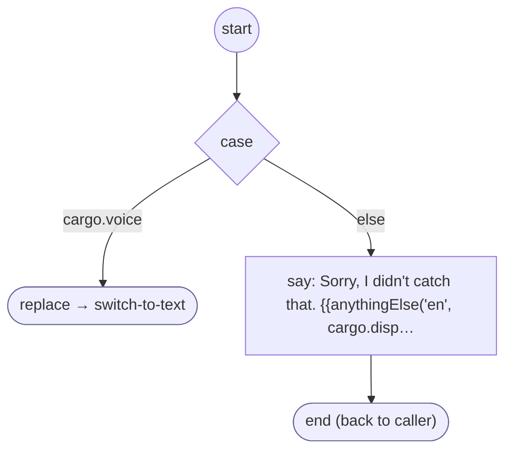

# Keypad9

<!-- generated:start -->
**Keypad9** · `9` · version 1.0.0 · worker (called by other flows) · steps

> Worker: the keypad key 9 when no question took it (no flow running, or a question passed it on with DISPATCH): matched by id, with no AI. On a call it is the switch to text (owner 2026-10-17: the key is handled once here, not at every question); in writing it is not a request.

- **Parameters:** none
- **Calls:** [switch-to-text](switch-to-text.md) (replace)
- **Tools:** none
- **Called by:** nothing (unreachable)

### Steps

<!-- generated:end -->
