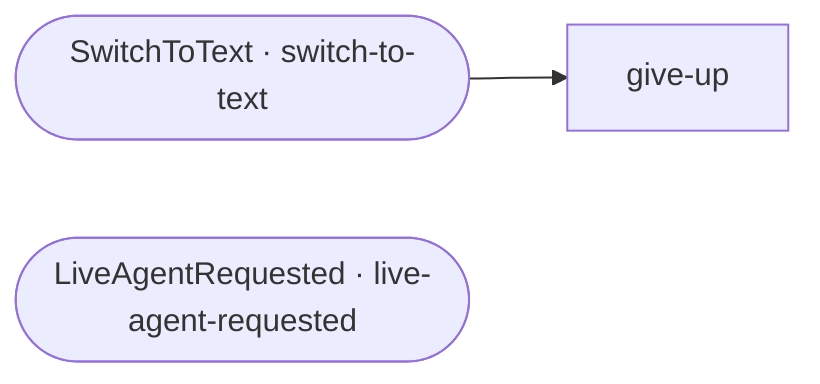

# System flows

<!-- generated:start -->
81 flows (2 entry points), 12 tools. The graph shows each entry point and the flows it reaches directly; a dotted arrow is a flow named rather than called (a hook, a prepare or present step, a default target). Each flow page charts its declarations: a provider (gate, source, facts, menu), a form (inputs in order, then its after steps), a performer (prepare, present, action) and any step list.

## Entry points

| flow | kind | what it is |
|---|---|---|
| [switch-to-text](switch-to-text.md) | steps | Customer explicitly asks to continue this conversation by text message / SMS ('switch to text', 'text me instead', 'can we continue by text… |
| [live-agent-requested](live-agent-requested.md) | steps | Customer wants to talk to a person, or says just 'agent' / 'AGENT': a live agent, a representative, customer service ('agent', 'speak to an… |

## Workers

| flow | kind | what it is |
|---|---|---|
| [no-action-needed](no-action-needed.md) | steps | Handle case where no action is needed like when user is already authenticated |
| [cancel-process](cancel-process.md) | steps | Handle flow cancellation by user |
| [contact-support](contact-support.md) | steps | Worker: give the tenant's customer-service contact information. Params: support_context(_es), closing_prompt(_es). |
| [authenticate-user](authenticate-user.md) | steps | Authenticate a contact using shared FORM collection and one-time-code services. |
| [get-cell-or-email](get-cell-or-email.md) | steps | Identify a supplied contact or account number; collect missing data through a FORM, with caller-ID eligibility and bounded contact validati… |
| [get-and-validate-otp-code](get-and-validate-otp-code.md) | steps | Collect a one-time-code answer through the owning FORM ancestry, preserving protocol commands for validation. |
| [validate-otp-code](validate-otp-code.md) | steps | Validate a challenge response with explicit bounded retries, alternate-contact handling and tenant callbacks. |
| [resend-otp-code](resend-otp-code.md) | steps | Worker: send a fresh one-time code to the destination authenticate-user used. Params: resend_reason. |
| [generic-retry-with-options](generic-retry-with-options.md) | steps | Collect a retry, alternate contact, code or exit through the shared FORM adapter. |
| [otp-send-failed](otp-send-failed.md) | steps | Worker: a code could not be sent (cargo.otpSendFailure). A line that cannot receive texts goes to otp-text-undeliverable; any other failure… |
| [text-destination](text-destination.md) | steps | Worker: where a text to the customer can go. Sets cargo.textTo (10 digits: the verified cell, else the caller's phone on a call; '' when th… |
| [send-text](send-text.md) | steps | Worker: texts `message` to cargo.textTo (call text-destination first). Sets cargo.textSent. |
| [send-otp-code](send-otp-code.md) | steps | Worker: sends a one-time code to cargo.otp_cell_number (SMS) or cargo.otp_email. Never texts a number that cannot receive texts (cargo.otpU… |
| [otp-text-undeliverable](otp-text-undeliverable.md) | steps | Worker for authenticate-user: the number cannot receive texts; ask for an email or a mobile number. The question is a form question (collec… |
| [give-up](give-up.md) | steps | Worker: a flow could not finish (tries ran out or a service failed); says so and hands off to live-agent-requested. Params: context / conte… |
| [ask-choice](ask-choice.md) | steps | Worker: ask one question and return cargo.choice plus the original cargo.choiceText. Declared choices, precheck keys and typed answer-valid… |
| [late-code-reask](late-code-reask.md) | steps | Worker (ask-choice, at the first question after a code was accepted): says the code was already verified and asks the question again, for a… |
| [ask-email](ask-email.md) | steps | Collect an email through shared FORM matching, retaining field-specific spelling and readback behavior. |
| [ask-address](ask-address.md) | steps | Worker: a new mailing address (zip, street, unit; Google-checked; read back for YES / NO). The address is step data (owner decision 2026-10… |
| [ask-field](ask-field.md) | steps | Worker: one card field, kind 'card' / 'exp' / 'cvv' / 'zip'. Sets cargo.field and cargo.fieldOutcome ('ok' / 'link' / 'failed'); the answer… |
| [card-entry](card-entry.md) | steps | Worker: a new card's number, expiration, security code and billing zip (each through ask-field), and whether to save it. Every field the ca… |
| [9](9.md) | steps | Worker: the keypad key 9 when no question took it (no flow running, or a question passed it on with DISPATCH): matched by id, with no AI. O… |
| [0](0.md) | steps | Worker: the keypad key 0 when no question took it (no flow running, or a question passed it on with DISPATCH): matched by id, with no AI. A… |
| [send-email-message](send-email-message.md) | steps | Worker: emails `message` with `subject` to `to`, with an optional copy to `cc` (e.g. the account's email on file when the caller chose anot… |
| [run-form](run-form.md) | steps | Worker (shared scope, called by a form flow): the FORM loop. Merges the form's activation parameters into cargo.forms[rf_form] once, then e… |
| [collect-input](collect-input.md) | steps | Worker: ask the form's current input once and file the answer wherever it belongs in the form chain (matchInputs, decided by scope; a decla… |
| [collect-input-accept](collect-input-accept.md) | steps | Worker: validate all readings, commit accepted changes once with transitive invalidation, then acknowledge and run declared callbacks. |
| [disambiguate-input](disambiguate-input.md) | steps | Worker: the answer fits two or more inputs at the same scope (or a declared confirm_against pair). Stores the unambiguous readings, asks wh… |
| [form-done](form-done.md) | steps | Worker: a finished form hands its values to its parent's result input (a sub-form) and to cargo.formResults[form], without pii values unles… |
| [validate-card-number](validate-card-number.md) | steps | Validator: a card number passes the Luhn check (validateCardNumber). Params: input, value. |
| [validate-card-expiration](validate-card-expiration.md) | steps | Validator: month (a number or its English or Spanish name) and year, a real month, not expired (validateExpiration). Normalizes to MMYY. Pa… |
| [collect-phone](collect-phone.md) | form + steps | Field collector: the phone number (preset 'phone'). Result: cargo.formResults['collect-phone'].phone. |
| [collect-email](collect-email.md) | form + steps | Field collector: the email address (preset 'email'). Result: cargo.formResults['collect-email'].email. |
| [collect-zip](collect-zip.md) | form + steps | Field collector: the ZIP code (preset 'zip'). Result: cargo.formResults['collect-zip'].zip. |
| [collect-street-address](collect-street-address.md) | form + steps | Field collector: the street address (preset 'street_address'). Result: cargo.formResults['collect-street-address'].street_address. |
| [collect-city](collect-city.md) | form + steps | Field collector: the city (preset 'city'). Result: cargo.formResults['collect-city'].city. |
| [collect-card-number](collect-card-number.md) | form + steps | Field collector: the card number (preset 'card_number'). Result: cargo.formResults['collect-card-number'].card_number. |
| [collect-card-expiration](collect-card-expiration.md) | form + steps | Field collector: the expiration date (preset 'card_expiration'). Result: cargo.formResults['collect-card-expiration'].card_expiration. |
| [collect-card-cvv](collect-card-cvv.md) | form + steps | Field collector: the security code (preset 'card_cvv'). Result: cargo.formResults['collect-card-cvv'].card_cvv. |
| [collect-card-zip](collect-card-zip.md) | form + steps | Field collector: the billing ZIP code (preset 'card_zip'). Result: cargo.formResults['collect-card-zip'].card_zip. |
| [collect-address](collect-address.md) | form + steps | Sub-form: street address, city, state, ZIP, in any order. Result: the parent's result input (or cargo.formResults['collect-address']). |
| [collect-credit-card](collect-credit-card.md) | form + steps | Sub-form: card number, expiration, security code, billing ZIP, in any order. Result (with keep_pii for the charge step): the parent's resul… |
| [provide-data](provide-data.md) | steps | Worker: answer a question about a provider catalog. Resolves `asked` (a fact or set key; empty = ask which), passes the catalog's gate for … |
| [load-source](load-source.md) | steps | Worker: load a provider's data when missing or stale (refresh: per_session / per_turn / max_age_ms) through the tenant's loader flow (sourc… |
| [answer-facts](answer-facts.md) | steps | Worker: say the facts `keys` of a provider catalog in one message, each from its path in the source result through its sentence template (s… |
| [confirm-form](confirm-form.md) | steps | Worker: ask a form's confirmation (exact YES / NO; keys 1 and 2). A correction instead ('no, make it $40') is read against the form chain a… |
| [provider-menu](provider-menu.md) | steps | Worker: after a provider answered, offer its menu (provides.menu: question(_voice)(_es) with {verb} / {name}; choices [{ key, phrases, flow… |
| [validate-input-batch](validate-input-batch.md) | steps | Worker: validate dependency-ordered candidates; return accepted, rejected and pending readings before a single commit. |
| [input-accepted-effects](input-accepted-effects.md) | steps | Worker: acknowledge accepted or rejected candidates and run their callbacks after the batch commit. |
| [perform-action](perform-action.md) | steps | Worker: enforce form, gate and confirmation invariants; invoke a declared action once per prepared request and retain its explicit outcome. |
| [operation-failed](operation-failed.md) | steps | Return an explicit transport failure to the invoking performer or provider. |
| [send-text-action](send-text-action.md) | steps | Worker: send the explicitly prepared text through the platform transport; sent or unknown result, with no automatic resend. |
| [prepare-input](prepare-input.md) | steps | Worker: run a field or group preparation once before prompting or validation, against committed prerequisites. |
| [collect-service-answer](collect-service-answer.md) | form + steps | Collect one protocol answer against explicit profiles and the owning FORM ancestry; return its accepted readings and original text. |
| [service-answer-raw](service-answer-raw.md) | steps | Leave protocol commands to their owning service rather than the generic menu transport. |
| [contact-caller-declined](contact-caller-declined.md) | steps | Repeat contact collection without offering caller ID. |
| [contact-split-failed](contact-split-failed.md) | steps | Restart a split identifier after too many digits. |
| [contact-not-on-file](contact-not-on-file.md) | steps | Re-collect a rejected account contact, then offer the common retry menu at the rejection limit. |
| [collect-geocoded-address](collect-geocoded-address.md) | form + steps | Collect a mailing address in any order, project geocoder evidence, and read the complete address back for confirmation. |
| [address-zip-validate](address-zip-validate.md) | steps | Read city and state from geocoder evidence for the proposed ZIP; missing geocoder data requires an explicit city. |
| [address-street-validate](address-street-validate.md) | steps | Validate a proposed street against its ZIP; retain unverified wording when geocoding is inconclusive. |
| [address-zip-prompt](address-zip-prompt.md) | steps | Render the ZIP retry wording from the owned address instance. |
| [address-street-prompt](address-street-prompt.md) | steps | Include the ZIP-derived location when asking for the street. |
| [collect-geocoded-address-declined](collect-geocoded-address-declined.md) | steps | Ask which part of the declined address is wrong, re-ask only that part, or start a fresh pass. |
| [resume-identity-caller](resume-identity-caller.md) | steps | Resume the caller of an account recovery with its original FORM instance and gate policy. |
| [provide-queued-data](provide-queued-data.md) | steps | Worker: answer the deduplicated private questions deferred during one owning task gate, checking each catalog before retrieval. |
| [task-gate](task-gate.md) | steps | Mark the lifecycle of a task-owned gate so private provider questions wait for the existing gate rather than opening another. |
| [resume-form](resume-form.md) | steps | Resume an owned form instance with its validated progress and saved arguments. |
| [confirm-input-proposal](confirm-input-proposal.md) | form + steps | Confirm an owned validated input candidate; retain it on yield and authorize only normal input acceptance. |
| [confirm-input-proposal-declined](confirm-input-proposal-declined.md) | steps | Reject an owned input proposal without accepting its candidate or handing incomplete data to its parent. |
| [request-cancelled](request-cancelled.md) | steps | Retire an explicitly withdrawn owning request and acknowledge it; preserve unknown actions for reconciliation. |
| [read-form-response](read-form-response.md) | steps | Read the requested field with contextual DISPATCH: an answer continues, an answer with nothing usable is asked again, a withdrawal or a new… |
| [collect-contextual-answer](collect-contextual-answer.md) | form + steps | Collect one open-ended answer using contextual DISPATCH and preserve the caller wording. |
| [address-city-prompt](address-city-prompt.md) | steps | Ask which of the ZIP code's place names the address carries. |
| [read-form-reply](read-form-reply.md) | steps | Rank an unreadable answer against its question: a request for a person or for text is taken; an answer is asked again; a withdrawal or a ne… |
| [read-form-choice](read-form-choice.md) | steps | Rank an unreadable answer to a choice question and take the offered option it picks, or a request for a person or for text; otherwise ask a… |
| [read-confirm-reply](read-confirm-reply.md) | steps | Rank an unreadable answer to a confirmation: it declines (NO), picks another of the form's choices (a correction, read as that input's answ… |
| [validate-card-cvv](validate-card-cvv.md) | steps | Validator: the security code has the length of its card brand, 4 digits for American Express (34, 37) and 3 for every other brand; with no … |
| [send-otp-email-too](send-otp-email-too.md) | steps | Email a second one-time code to the account's email beside the texted one, and say so. |
<!-- generated:end -->

## How to read these docs

Each flow page has a generated part (facts and charts, rewritten from `flows/system.flows.json`). The native forms in this set are built from `src/forms`; the rest is copied from the deployed set. Run `node scripts/flow-docs.mjs` after changing `flows/`. The other sets: [shopify](../shopify/README.md).

## Conventions Used by These Flows

**Primary vs. sub-flow.** Two system flows are `primary: true`, so intent detection can start them: `switch-to-text` and `live-agent-requested`. The others omit `primary` and are reached from a `FLOW` step or an `onFail`. Both primary flows are also reached that way (the retry menu reboots into `switch-to-text`, and every "agent" answer reboots into `live-agent-requested`).

**Keypad flows.** The flows with ids `9` and `0` are not primary. Intent detection first compares the whole input with every flow's id and name (case-insensitive), primary or not, before any AI is asked, so an input of exactly `9` or `0` that reaches intent detection (no flow running, or a question that passed it on with `DISPATCH`) starts Keypad9 or Keypad0.

**Call types** (as used here):
- `call`: run the sub-flow, then resume the caller. The sub-flow works on the caller's variables (the same object), so what it sets (`cell_number`, `email`, `contact_valid`, `auth_result`…) is visible to the caller. Any `value` the sub-flow's `variables` block declares is written into that shared object when it starts.
- `replace`: the current frame becomes the target. Its remaining steps are dropped, and its variables are kept with the FLOW step's `parameters` merged in. The target's declared variable defaults are **not** applied.
- `reboot`: clear every active flow and start the target as the only flow, with fresh variables (the global variables, the target's declared defaults, then the `parameters`). SAY output accumulated before the reboot is kept and delivered with the target's output.

**Variable scope.** The five generic workers (`ask-choice`, `ask-email`, `ask-address`, `ask-field`, `card-entry`) declare `scope: "isolated"`. A `call` or `replace` into an isolated flow starts it with only its declared variables and the parameters actually passed (an omitted parameter is `undefined`, never the caller's value), and its variables never reach the caller. They return their results in `sessionContext.cargo` instead (`cargo.choice`, `cargo.email`, `cargo.address`, `cargo.field`, `cargo.payMethod`…). Every other system flow uses the default `shared` scope described under `call` above. A FLOW parameter that is a single `{{…}}` template (e.g. `"capture_patterns": "{{cargo.authCapture}}"`, `"digits": "{{af_digits}}"`) passes the value itself, array or object included, not its string form.

**Ending a flow.**
- `RETURN` terminates **all** flows and makes its value the response. `RETURN ''` (used by `no-action-needed`) produces an empty response, so the host handles the user's message itself.
- `END` returns from the current flow only, resuming its caller.
- `DISPATCH` terminates **all** flows (queued SAYs included) and routes the turn's input through intent detection; with no match the response is empty and the host answers. The ended flows' declared outcome is kept only on a no-match. Used by `get-cell-or-email` for an off-topic answer, by `generic-retry-with-options` for an unrecognised one, and by `ask-choice` for an answer that picks no choice or is a new request (it declares an outcome only when its exit context is `payment`).
- A terminal step may declare `outcome` / `reason` (both may be `{{…}}` templates; an outcome that interpolates to empty declares nothing). The engine reports a declared outcome once in `sessionContext.lastFlowOutcome`, and `unresolved` also fails that flow's transaction. The system flows declare:

| Flow | Step | `outcome` / `reason` |
|---|---|---|
| contact-support | `say_support_message` (SAY) | `support_outcome` or `unresolved` / `support_reason` or `contact_support_fallback` |
| get-cell-or-email | `off_topic_handoff` (DISPATCH) | `unresolved` / `auth_prompt_off_topic` (kept only when no flow matches); `user_aborted` / `auth_prompt_off_topic` when the caller withdraws |
| generic-retry-with-options | `dispatch_unrecognised` (DISPATCH) | `caller_outcome` / `caller_reason` (empty = none) |
| ask-choice | `ac_elsewhere`, `ac_other_request` (DISPATCH) | `unresolved` / `payment_incomplete` when the exit context is `payment` (empty = none otherwise) |
| live-agent-requested | `say_live_connect` (RETURN) | `resolved` / `live_connect_link` |
| live-agent-requested | `say_cannot_connect` (RETURN) | `resolved` / `no_agent_reachable` |
| live-agent-requested | `no_agent_available`, `no_agents_available` (RETURN) | `unresolved` / `agent_unavailable` |

**`onFail` on a CALL-TOOL.** A `FLOW` `onFail` runs with its `callType` (default `replace`): `replace` / `reboot` leave the failed flow, `call` runs the handler and then resumes the failed flow at its next step. A non-FLOW `onFail` (SAY / SET / RETURN) runs **immediately** after the failed tool step; a SAY or SET then lets the flow continue with its remaining steps, a RETURN ends it. Before the onFail runs, the CALL-TOOL `variable` holds the error text (a truthy string with no `.success`), so a SET `onFail` that writes a `{ success: false }`-style value is the safest pattern, and a SAY `onFail` is followed by the flow's remaining steps, which may contradict it. This behaviour needs jsfe 0.9.89 or later.

**Cargo the flows read or write** (`sessionContext.cargo`, set by the host unless noted):

| Field | Used by | Meaning |
|---|---|---|
| `cargo.voice` | most flows | truthy on a voice call. Adds keypad wording ("press 1", "the asterisk key") to prompts, and turns on the engine's AI voice-input cleanup for SAY-GET answers |
| `cargo.verb` / `cargo.verb_es` | most prompts | the verb inserted into prompts ("Please {{cargo.verb}} …") |
| `cargo.callerId` | get-cell-or-email, switch-to-text, generic-retry-with-options, text-destination | the caller's number, offered as the contact. Without it `switch-to-text` cannot text, and the retry menu does not offer TEXT |
| `cargo.twilioNumber` | send-otp-code, switch-to-text, validate-otp-code, text-destination, send-text | the `from` number for SMS. text-destination sets no destination without it |
| `cargo.agentPhoneNumber` | live-agent-requested | a transfer number for this turn; absent when no agent can take a transfer now |
| `cargo.agentHours` / `cargo.agentHours_es` | live-agent-requested | the agent hours of the phone number's schedule, as a sentence (in or out of hours). Empty when the number has no agent schedule; absent on every non-phone channel |
| `cargo.agentUnavailableMessage` | live-agent-requested | the phone number's own "no agent available" wording (a voice setting); empty = the flow's default |
| `cargo.contact_info` | contact-support, live-agent-requested | the support contact text (one value for both languages) |
| `cargo.support_context` / `_es` | contact-support | topic phrase, e.g. set to `orders` / `pedidos` by `shopify-track-order`, or written by contact-support from its `support_context` / `support_context_es` parameters |
| `cargo.sessionResolved` | contact-support | truthy when something was resolved earlier in the session; contact-support then thanks instead of apologizing. The reference host sets it when a flow declares outcome `resolved` |
| `cargo.displayName` / `cargo.callerNamed` | get-and-validate-otp-code, Keypad9; cleared by authenticate-user (ANOTHER ACCOUNT) | the name the conversation addresses the customer by (set by the host or by `set-user-name`), and whether the tenant took it from the caller ID's account |
| `cargo.otpVerified` | authenticate-user, validate-otp-code, generic-retry-with-options | written by the `validate-otp` tool on success |
| `cargo.authOptions` | written by authenticate-user; read by authenticate-user when `retrying` | `{ retry_flow, cancel_flow, email_validator, cell_validator, code_validator, answer_handler, retry_returns }` of the authentication in progress, written at its start. A retry from the menu (`retrying: true`) restores all seven from it. validate-otp-code reads `code_validator` and `answer_handler` from it |
| `cargo.authRetry` | written by authenticate-user; read by the flow that called it | true when this run of authenticate-user is a retry from the menu with no contact and the authentication was started with `retry_returns: true`; authenticate-user then ends at once so its caller asks for the contact its own way. False on every other run. No system flow reads it |
| `cargo.authOtherAccount` | written by validate-otp-code; read by the flow that called authenticate-user | the account the caller named at the code question, when the authentication's `code_validator` answered `answer_key: 'another_account'` with it as `answer_value`. No system flow reads it |
| `cargo.callerDeclined` | written by authenticate-user (ANOTHER ACCOUNT); read by get-cell-or-email | true once the caller said ANOTHER ACCOUNT after the caller ID was used without asking. For the rest of the session get-cell-or-email treats `caller_on_file` as `'no'`: the caller ID is neither offered nor used |
| `cargo.gcePartial` | get-cell-or-email (with `merge_partials`) | the digits of an account number given so far in pieces; `''` when none is being joined |
| `cargo.gceChecks` | get-cell-or-email | `{ '<validate_flow>|phone:<10 digits>' or '<validate_flow>|email:<address>': contactCheck }`: what `validate_flow` answered for each contact this session, so a contact is validated once |
| `cargo.authCapture` | written by get-cell-or-email; read by authenticate-user, get-cell-or-email, validate-otp-code, resend-otp-code, otp-send-failed | the contact capture patterns every authentication retry menu passes as `capture_patterns`: `[{ variable: 'cell_number', reader: 'phone' }, { variable: 'email', reader: 'email' }]` (see `normalizeAndFindCapture`) |
| `cargo.authCancelFlow` | written by authenticate-user; read by validate-otp-code, otp-text-undeliverable and the code-failure menus (`cancel_flow` of the authentication retry parameters) | the authentication's `cancel_flow` (default `contact-support`), so EXIT goes to the same flow at every step. Readers fall back to `contact-support` when it is empty |
| `cargo.otp_cell_number` / `cargo.otp_email` | written by authenticate-user; read by send-otp-code, get-and-validate-otp-code, validate-otp-code, text-destination | where the OTP is sent |
| `cargo.otpSendFailure` | written by send-otp-code; read by authenticate-user, resend-otp-code, otp-send-failed | why the last send did not go out: `''` (sent), `undeliverable` (the line cannot receive texts), `sms`, `email` (that send failed) or `none` (no destination). Cleared at the start of every send |
| `cargo.otpSentOn` | get-and-validate-otp-code | how the code went out (`sms`, `email`, `whatsapp`), written by the host's send functions. `whatsapp` = the code was sent in this WhatsApp chat |
| `cargo.otpFailure` | validate-otp-code | why `validate-otp` refused a code: `missing`, `expired` or `mismatch`. Written by the host's `validate-otp`; cleared by a successful check and by every new send |
| `cargo.otpMismatches` | authenticate-user (reset to 0), validate-otp-code (counts, caps at 3) | wrong codes in this authentication |
| `cargo.otpResends` | authenticate-user (reset to 0), resend-otp-code (counts, caps at 2) | fresh codes sent in this authentication |
| `cargo.otpHash` | validate-otp-code | the pending code's hash (written by the send tools). validate-otp-code sets it to `null` at the wrong-code cap, which withdraws the code |
| `cargo.otpUndeliverableTo` | send-otp-code, otp-text-undeliverable, text-destination | the last 10 digits of a number that cannot receive texts (landline, toll-free, invalid). Written by the host's `send-sms-otp` when the destination refuses the text, and cleared by its next send |
| `cargo.textTo` / `cargo.textTo4` | written by text-destination; read by send-text and its callers | where a text to the customer can go: 10 digits, `''` when none; and its last four, comma-spaced on voice |
| `cargo.textSent` | written by send-text; read by its callers | true when `send-twilio-sms` returned a status for the text; false when there was no destination or the send failed |
| `cargo.emailSent` | written by send-email-message; read by its callers | true when `send-email` completed; false when `to` is not a valid address or the send failed or was refused |
| `cargo.choice` / `cargo.choiceText` | written by ask-choice; read by ask-email, ask-address, ask-field, card-entry and other callers | the key of the choice the answer picked (`'other'` for any other answer when `accept_other`), and the answer as given. Both `''` at the start of every ask-choice. ask-field sets `cargo.choiceText = ''` as soon as it has read it |
| `cargo.sensitive` | written by card-entry; read by ask-choice | paths inside the cargo (`['field']`) that hold card data. When an ask-choice answer leaves through AGENT, EXIT or `DISPATCH`, each path is set to `null` first. card-entry does not clear the list |
| `cargo.email` | written by ask-email; read by its callers | the address ask-email collected, `''` when none. Not the OTP destination (`cargo.otp_email`) |
| `cargo.address` | written by ask-address; read by its callers | `{ line, street, said, verified }` once the caller confirmed the address; `null` otherwise |
| `cargo.addressDraft` | ask-address | `{ zip, said, unit, place }`: the parts of the address the caller has given so far, from `given` or from any answer. Each question is asked only while its part is missing. Kept until the read-back is answered: `null` after YES and after any other answer |
| `cargo.field` / `cargo.fieldOutcome` | written by ask-field; read by card-entry | the validated value (`''` unless ok) and `'ok'`, `'link'` (the caller asked for a payment link) or `'failed'` (invalid twice; the card number three times when its second answer was another card entry) |
| `cargo.payMethod` | written by card-entry; read by its callers | the card just collected, `cargo.pendingCards[0]`: `{ kind: 'card', card: { cardNumber, expirationMonth, expirationYear, cvv, zip }, save, last4, type: '', pending: true, label, label_es }`. card-entry does not clear it at the start |
| `cargo.cardDraft` | card-entry | `{ number, exp, cvv, zip }`: the card fields collected so far. Each field is asked only while it is missing, so a card entry that stopped part way resumes there. `null` once the card is complete |
| `cargo.pendingCards` | written by card-entry; read by its callers | every card completed in this session, newest first (a card entered again replaces its earlier entry). card-entry never clears it |
| `cargo.saveCardPick` | card-entry | `'yes'` / `'no'`: the caller's answer to the save question. When set, card-entry does not ask it again |
| `cargo.payNext` | written by card-entry; read by its callers | `'link'` when the caller asked for a payment link at a card field, `'card_failed'` when a field failed (ask-field's `'failed'`). Not written when the card was collected, and not cleared at the start |

**Global variables** (tenant-level, optional): `global_whatsapp_invite` / `global_whatsapp_invite_es` (validate-otp-code; empty or absent = the WhatsApp invite is off), `global_live_agents_comment` / `global_live_agents_comment_es` (live-agent-requested: on non-phone channels, and on the phone when the number's schedule gives no hours).

**Host functions called in expressions.** The flows call `isAnswer`, `isAgentRequest`, `isExitRequest`, `isOtherRequest`, `isAmountAnswer`, `amountInAnswer`, `pickChoice`, `matchesChoice`, `readEmail`, `readPhone`, `readIdentifier`, `readInternationalPhone`, `callerIsInternational`, `callerTextNumber`, `textDestination`, `validatePhone`, `validateEmail`, `validateCardNumber`, `validateExpiration`, `normalizeAndFindCapture`, `textWithUrlToSpeech`, `last4` and `anythingElse` inside conditions, SET values and `{{…}}` templates. The engine does not provide them: the host must register them in `APPROVED_FUNCTIONS`. `demos/make-payment.js` has reference implementations of `matchesChoice` (exact word / word-sequence membership, not substring matching), `validatePhone`, `validateEmail` and `textWithUrlToSpeech`.

**Contact readers** (in the reference host, hy-rag-lambdas, `foundation/text/contact.js`), one way to read a contact for every flow set:
- `readEmail(text)` returns the email address in the answer, lower-cased, or `''`. `at` / `arroba` and `dot` / `punto` may be spoken, and the name before the @ may come in several pieces ("R. A Alvarado at aura.com", "j u a n"): every piece back to the first lead-in word ("my email is", "mi correo es", "yes", "hola") is kept and joined. Accents are dropped from the name, and only the last @ counts.
- `readPhone(text)` returns the answer's digits when there are exactly 10, or 11 starting with `1` (the `1` dropped); otherwise `''`.
- `callerTextNumber(cargo)` is ONE rule for whether a text can reach the caller: the caller ID as 10 digits only on a call with a sender (`cargo.twilioNumber`), for a US / Canada number (10 digits, or 11 starting with `1`), and not the number a code could not be texted to (`cargo.otpUndeliverableTo`); otherwise `''`. `textDestination(cargo)` is where a text goes: the verified cell (`cargo.otp_cell_number`, by the same rule), else `callerTextNumber`.
- `readIdentifier(text, accountPattern)` returns `{ kind: 'account' | 'phone' | 'email', value }` or `null`, the tenant's account-number shape (a regex on the answer's digits) winning first. get-cell-or-email calls it with its `account_pattern`.
- `last4(value, voice)` returns the last four characters of a number as said to the customer: one by one with commas on a call ("1, 2, 3, 4"), as written otherwise ("1234").

`normalizeAndFindCapture(answer, patterns)` is the retry menu's smart capture (in the reference host, `foundation/text/capture.js`). Each pattern is either `{ variable, reader }`, where `reader` is `'phone'` or `'email'` and the answer is read with `readPhone` / `readEmail`, or `{ variable, regex, normalizer? }`, where the `normalizer` regex (global) is removed from the answer first and `regex` is run on the result. The first pattern that yields a value returns `{ variable, value }`; for a regex pattern `value` is **the matched part only**, trimmed ("my email is a@b.com" captures `a@b.com`). No match, or `patterns` not an array, returns `null`. A pattern whose regex is invalid is skipped with a warning. Every system menu passes the reader patterns of `cargo.authCapture`. The copy in `demos/make-payment.js` handles regex patterns only and returns the whole normalized answer instead of the matched part.

**Phrases** (in the reference host, `foundation/text/phrases.js`): `anythingElse(lang, name)` is the closing question in the turn's language (`'en'` when it is neither `'en'` nor `'es'`), addressed by name when one is known: "Is there anything else I can help you with[, {name}]?" / "¿Hay algo más en lo que pueda ayudarle[, {name}]?". A name stored in capitals is said in title case.

**Card checks** (in the reference host, `foundation/payment/card-checks.js`), used by ask-field: `validateCardNumber(digits)` is true for 12 to 19 digits that pass the Luhn checksum; `validateExpiration(mm, yy)` is true for a real month that has not passed, at most 20 years out.

**Answer vocabulary.** The YES / NO / AGENT / EXIT / TEXT words are not in the flows. They live in the host's answer module (in the reference host, hy-rag-lambdas, `foundation/text/answer.js`), one list per kind shared by every flow set. Words match whole words or word runs, never substrings.
- `isAnswer(input, kind, extra?)` returns whether the answer is a `kind` answer (for `yes`, only an answer of nothing but affirmatives, courtesy aside), `kind` being one of `yes`, `no`, `agent`, `exit`, `text`, with the caller's `extra` words added to that kind's list. `0` is AGENT and `*` is EXIT. A negated answer ("not sure", "I don't want an agent") never matches YES, AGENT or TEXT.
- `isAgentRequest(input)` returns whether the whole answer asks for a person ("agent", "I want to talk to a representative", "hablar con una persona") or is `0`. A negated answer never does. Used at free-text prompts, where an AGENT word inside a longer answer is not a request.
- `isExitRequest(input)` returns whether the whole answer is an EXIT word (exit, quit, abort, salir, cancel, cancelar; "please" / "por favor" allowed) or is `*`. A sentence that contains one ("Cancelar el pedido", "quiero cancelar") is not: it asks for something. Every EXIT in the authentication flows uses it.
- `pickChoice(answer, choices, acceptOther)` is ask-choice's matcher: it returns the key of the choice the answer picks, `__agent`, `__exit`, or `''` for no choice. Its rules are under AskChoice.
- `isOtherRequest(input, kind)` returns whether a free-text answer to a question that expects `kind` (`number`: a digit or a number word in English or Spanish; `email`: `@`, "at", "arroba", "dot", "punto" or a common mail domain; `contact`: either) is a new request rather than an attempt: three or more words, none of that shape. ask-choice's `expect` uses it.
- `isAmountAnswer(input)` returns whether the answer names an amount: a `$`, a currency word (dollar(s), dólar(es), buck(s), cent(s), centavo(s)), or a number with one or two decimals after `.` or `,` ("12.50"). `pickChoice` never lets such an answer pick a keypad key or `0` (agent), so "$1" is never a plain `1`. ask-choice's `amount` uses it.
- `readInternationalPhone(text)` returns the digits of a number from outside the US and Canada in the answer, or `''`: with a prefix (`+`, `00`, "plus", "más"), 8 to 15 digits; without one, 11 to 13. An answer holding an email address or a US / Canadian number, or whose digits start with `1`, returns `''`, so a card or account number is never taken for one. `callerIsInternational(cargo)` returns whether, on voice, `cargo.callerId` has 8 or more digits and is not a US / Canadian number (10 digits, or 11 starting with `1`). A text can reach only US and Canadian numbers, so the flows below say so rather than offer one.

**`digits`** on a SAY-GET (`{ min, max, autoSubmitChars?, autoSubmitMs?, complete? }`) is copied by the engine to `cargo.digits` while the answer is awaited, for the host's keypad handling (e.g. Twilio ConversationRelay). The engine removes it once the input is collected. ask-choice, whose SAY-GETs carry no `digits`, writes its `digits` parameter to `cargo.digits` itself before each question and removes it after the answer.

**`asSpoken`** on a SAY-GET (jsfe ≥ 1.3.0) stores the answer exactly as given: on voice it is neither reduced to its digits (as an answer fitting `digits` otherwise is) nor sent to the AI voice cleaner. `true`, or a condition on the flow's variables. ask-choice sets it on an amount question (`asSpoken: "ac_amount === true"`), so a spoken "$1." arrives as "$1." rather than `1`.

**`pii`** on a SAY-GET (jsfe ≥ 1.3.5) marks its answer as sensitive: while the question waits, the awaiting frame carries `pendingVariablePii`, so the host can keep the next input out of its own logs and records, and the engine replaces the answer with `•••` in its log lines for the turn that processes it. How the answer is stored and used is unchanged. `true`, or a condition on the flow's variables. ask-choice sets it on every question when its `pii` parameter is true (`pii: "ac_pii === true"`); ask-field passes `pii: true` for the security code (`kind: 'cvv'`).

---
